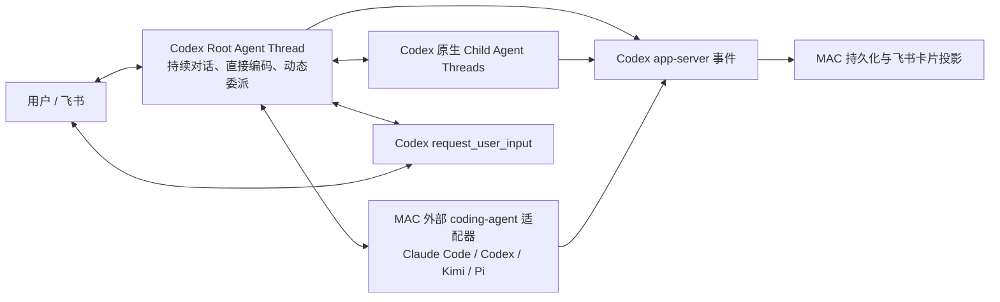

# MAC 架构

用户可观察的命令、卡片和状态语义以 [interaction-spec.md](interaction-spec.md) 为实施与验收基线；
本文只说明支撑这些行为的技术边界。

## 结论

MAC 的执行内核就是一个持久 Codex Root Agent Thread，不再另设 Coordinator Agent，
也不再用状态机预先规定需求、架构、编码、测试和返工阶段。

Root Agent 是普通的完整 coding agent：它可以直接读取、修改和运行当前项目，也可以按
Codex 原生规则调用 `spawn_agent`、`send_message`、`followup_task`、`interrupt_agent`、
`wait_agent` 和 `list_agents`。何时自己完成、何时委派、是否并行，都由同一 Root Thread
根据当前任务动态决定。

## 源码基线

实现固定对照 OpenAI Codex `rust-v0.144.1`，提交
`44918ea10c0f99151c6710411b4322c2f5c96bea`：

- `core/src/session/turn.rs`：同一 turn 内的模型—工具循环；
- `core/src/tools/handlers/multi_agents_v2/`：原生多 Agent 工具；
- `core/src/agent/control.rs`：Agent thread、消息、打断与状态；
- `core/src/agent/role.rs`：可选角色配置，不是固定流程；
- `app-server` 的 `thread/start`、`thread/resume`、`turn/start`、`turn/steer`、
  `turn/interrupt` 和事件协议；
- `item/tool/requestUserInput`：Root Agent 的原生用户提问协议。

MAC 不重新实现以上控制语义。升级 Codex 版本时先更新源码映射和协议测试，再升级运行时。

## 组件边界

| 组件 | 责任 |
|---|---|
| Codex Root Thread | 理解用户、直接完成工程工作、动态调用工具和 Child Agent、维护对话上下文 |
| Codex app-server client | 透明传输 thread/turn/event/server-request，不解释业务阶段 |
| ProjectService | 保存项目、Root thread identity、问题、通知、成本和展示投影 |
| Feishu adapter | 把用户消息 steer 到活跃 turn，或启动新 turn；把原生问题和事件渲染为卡片 |
| External agent adapter | 把 Claude Code、Codex、Kimi、Pi 等后端包装成 Root Agent 可调用的额外执行工具 |
| Runtime/hosting | 单一受管服务进程、服务地址、日志、计费与恢复 |

不存在以下组件：

- Coordinator Agent；
- 需求/架构/Spec/Coder/Tester/Reviewer 固定流水线；
- REWORK 状态和失败类型路由器；
- MAC 自己实现的 spawn/wait/followup 协议；
- 根据关键词或“任务复杂度”选择流程的逻辑。

## 生命周期

Project 只表达长期项目关系：`active / paused / cancelled`。一次 Root turn 结束表示“本轮
完成并可继续对话”，不把项目变成无法迭代的终态。

执行姿态只有：

- `running`：Root turn 或原生 Child Agent 正在工作；
- `waiting_user`：Codex 原生 `request_user_input` 正在等待答案；
- `waiting_external`：明确等待系统外部事件；
- `idle`：当前没有运行中的 turn，随时可继续。

飞书卡片直接投影 app-server 事件和以上持久状态，不维护第二份展示状态。

## 会话与上下文

- 一个项目对应一个持久 Root thread id；每条项目消息进入或 steer 到该 thread。
- 服务进程内复用同一个 app-server client 和已连接的 Root thread；turn 结束只释放本轮状态，
  不重复启动进程或回放历史。服务重启时才使用持久 thread id 恢复。
- Codex 自己负责 rollout、历史截断、compaction 和 Child Agent `fork_turns`。
- MAC 不把工具日志、Child Agent 全文结果或历史测试输出重新拼进下一轮 Prompt。
- 默认始终恢复同一 thread。只有用户显式发送 `/new`（兼容 `/newthread`）时，MAC 才调用原生
  `thread/start` 并替换项目绑定的 thread id；项目和目录保留，旧历史不 fork、不注入新会话。
- 项目目录是 Root Agent 的 cwd 和写入范围；workspace-write 下仍可按 Codex 原生权限读取
  相关参考目录。
- 项目中的 `AGENTS.md`、skills、工具和 Codex 用户配置按 Codex 原生加载机制生效。

## 用户交互

- Root Agent 是唯一智能对话身份，但不是一个特殊的 Coordinator 类型。
- 系统能读取、推导或验证的信息由 Agent 自己取得。
- 只有偏好、授权或系统无法取得的外部事实才询问用户。
- `request_user_input` 在原 turn 中等待飞书答案；回答后继续同一个 turn，不创建“恢复阶段”。
- 用户在运行中发送新消息时使用 `turn/steer`；Root idle 时开始下一 turn。
- 飞书收到消息后立即在用户原消息上添加回应并创建本轮进度卡；同一张卡持续投影准备、
  模型、工具、Child Agent、外部 Provider、等待和终态，不能用伪造百分比表示进度。
- 长时间没有新事件时，进度卡显示已等待时间和最后真实活动时间；服务重启中止 turn 时，
  原卡片变为“已中止并恢复空闲”，后台状态同步回到 `idle`。
- 面向用户的输出全部使用卡片。进度可以充分，但不得展示内部 task path、thread id、
  协议字段和原始工具日志。
- Project 是唯一导航边界，固定拥有工作目录和当前 Root Thread。`/open`（兼容 `/bind`）
  立即打开已有目录对应的 Project 并设为当前项目；同一用户已有同目录 Project 时恢复它，
  否则创建一个新的 Project。不存在独立的“下一次新建项目目录”状态。
- `/new` 只替换当前 Project 的 Root Thread，项目和工作目录保持不变；普通消息只能进入当前
  明确选中的 Project，不回退到用户最近更新的其他项目。
- 进度卡保存 Agent 公开 commentary 形成的大步骤历史，以及当前大步骤中的真实工具、验证、
  Child Agent 和外部 provider 小步骤历史。它是 app-server 事件投影，不是固定研发状态机。

## 外部 provider 选择

- `run_external_agent` 的 `provider` 由 Root Agent 在调用时显式选择，runtime 严格执行该
  provider，不静默 fallback。
- 工具向 Root 提供启用状态、非敏感配置说明，以及最近执行的进程完成率、平均耗时、平均
  工具调用数和已报告成本；这些指标只说明执行后端是否正常返回，不等于产物语义验收通过，
  且不暴露其他项目的任务内容。
- 用户显式指定 provider 时优先遵从；否则 Root 根据任务和上述证据动态决定，不使用关键词
  路由，也不按固定角色绑定 provider。
- 每次调用必须提供简短的用户可见选择理由，跟随用户当前语言且不含内部路由或协议黑话。
  飞书进度卡显示 provider、选择理由和外部 CLI 的真实活动状态。
- Codex 原生 Child Agent 角色与外部 provider 是两个维度：角色描述任务责任，provider 描述
  外部执行后端。普通委派优先使用 Codex 原生 Child Agent，只有独立 CLI 执行确有价值时才
  使用外部 provider。

## 动态工具与可配置角色

- 外部 CLI 作为 app-server `thread/start` 的 dynamic tool 注入；Codex 的 `thread/resume`
  不接受新的 dynamic tool 定义，因此不能假设旧 thread 会自动获得新 schema。
- MAC 为影响模型调用契约的 dynamic tool 名称和 input schema 计算版本指纹。指纹变化时为
  该项目启动一个兼容的新 Root thread；只改展示文案或运行指标不会无意义地重建 thread。
- `analyst`、`reviewer` 等可选角色通过 Codex 原生 `[agents.<role>]` 配置提供，仅描述委派时
  的责任和边界，不组成固定流水线；内置 worker 继续承担普通实现任务。

## 服务托管与恢复

- 本机服务由一个 launchd job 持有；启动脚本只安装、拉起并核对真实监听 PID，禁止同时
  存在 reload 进程、旧后台进程和新服务进程。
- 正常关闭会将正在执行的 native turn 标记为“被服务重启中止”。下次启动只消费一次该
  标记，恢复项目为 `idle`，并更新原有进度/问题卡，避免后台已恢复而前端仍显示运行中。
- 恢复不是伪造 turn 成功。未完成工作需要用户继续发送消息，由持久项目会话续接。

## MAC 扩展边界

MAC 只增加 Codex 产品本身没有的能力：

1. 飞书移动端交互与卡片状态同步；
2. 项目目录绑定和项目切换；
3. 外部 coding-agent 后端；
4. 本地服务托管、成本和 profiling；
5. 可靠通知、幂等和重启恢复。

这些扩展不得改变 Codex 的 turn loop、多 Agent 工具语义、上下文所有权和 Root Agent 权限。

## 不变量

1. 用户消息不会先被编译成固定阶段或 DAG。
2. Root Agent 第一轮就拥有正常 Codex coding 权限。
3. Codex 原生多 Agent 工具由 Codex 执行，MAC 只消费事件。
4. 同一 app-server request 只产生一次持久副作用和一张可更新卡片。
5. `request_user_input` 的答案返回原生请求；重启丢失内存请求时，答案作为下一 turn 的
   明确用户输入恢复。
6. 一轮结束后项目保持可继续迭代。
7. 外部 Agent 后端必须适配相同的任务、消息、打断、状态和成本语义，不能反向引入阶段流。
8. 不为单个用户措辞、项目名或错误文本增加关键词分支。
9. 同一服务进程内相邻 turn 复用 app-server；动态工具调用契约改变时才迁移 Root thread。

## 验证

修改执行内核后必须依次通过：

1. Root runtime 协议测试；
2. API、持久化和飞书投影测试；
3. 真实 Codex app-server 项目回合；
4. 真实飞书私聊界面测试；
5. 通过 MAC 对已有项目执行修改、调试和继续迭代；
6. 个人 Agent 项目的身份、风格、记忆、few-shot、skills、工具、发送文件和可访问性黑盒。
