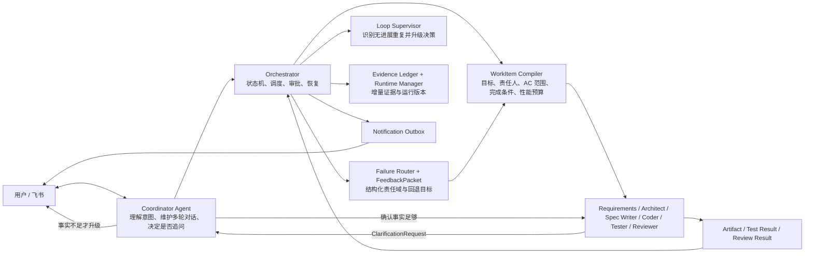
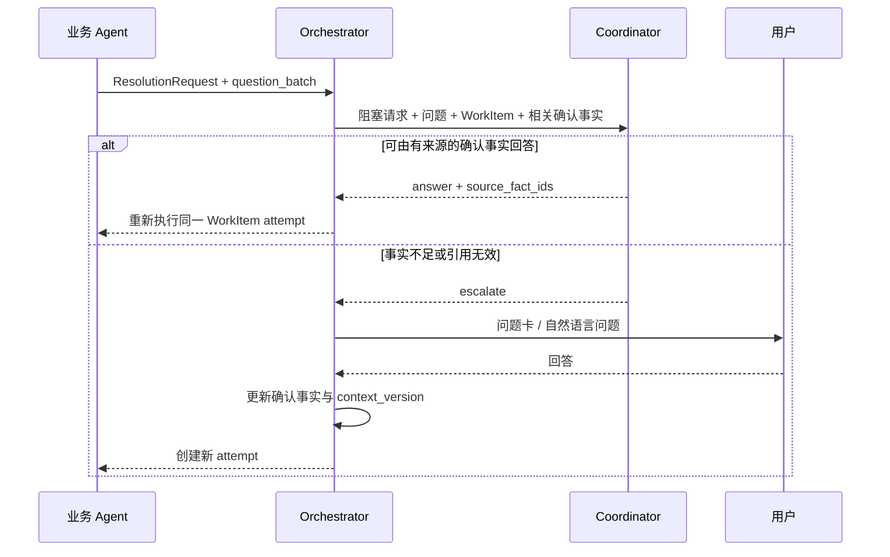

# MAC System 架构

## 设计结论

Coordinator 是唯一面向用户的对话与决策 Agent；Orchestrator 是 Coordinator 使用的确定性执行引擎，而不是第二个对话 Agent。Coder、Tester、Reviewer、Planner 等业务 Agent 只接收当前 WorkItem 所需的事实，并且只向 Coordinator 请求澄清。只有 Coordinator 判断现有确认事实不足时，问题才会升级给用户。

会话关联目录只决定项目归属、默认工作目录和交付写入目标，不限制 Coordinator 的只读事实获取。Coordinator 可在 `MAC_ALLOWED_BIND_ROOTS` 配置的宿主根目录内读取与当前问题相关的任意目录；读取参考项目不改变绑定。业务 Agent 仍只获得 WorkItem 明确需要的工作区、事实和上下文文件。

## 责任边界

| 组件 | 负责 | 不负责 |
|---|---|---|
| Coordinator | 多轮对话、话题关联、需求归一化、选择相关事实、回答 Agent 澄清、必要时询问用户 | 执行代码、直接推进状态机、向业务 Agent 暴露完整聊天记录 |
| Orchestrator | 状态流转、WorkItem 创建、Agent 调度、context version 校验、重试/取消/回退、卡片投递意图 | 自由对话理解、替用户补充未知业务事实 |
| 业务 Agent | 在 WorkItem 范围内生产阶段产物，发现缺口时提交 ClarificationRequest | 直接询问用户、读取无关事实、决定全局流程 |
| ProjectService | 持久化事实、问题、任务、反馈、审批、通知和审计事件 | 业务语义推理 |

## 角色与 Runtime 分配

规划阶段不再复用同一个 `planner` 任务身份。Prompt 文件可以继续复用历史命名，
但状态机、Task、失败归因、反馈和用户卡片使用独立 Agent 类型：

| 阶段 | Agent | 默认 Runtime | 选择理由 |
|---|---|---|---|
| 需求分析 | `requirements_analyst` | Claude Code | 擅长多轮语义归纳；只定义产品目标、边界和 AC，不做技术选型 |
| 架构设计 | `architect` | Codex | 侧重仓库分析、技术分解和工程约束，与需求模型解耦 |
| 实现计划 | `spec_writer` | Claude Code | 把已确认需求和架构整理成严格的可执行合同 |
| Bug 分析 | `bug_analyst` | Codex | 侧重复现和代码级根因定位，不直接修复 |
| 文档大纲 | `documentation_planner` | Claude Code | 侧重读者、信息结构和覆盖范围 |
| 编码 | `coder` | Codex | 使用独立 coding CLI 在任务 worktree 实现 |
| 测试 | `tester` | Claude Code | 对 Codex 实现做独立验证；质量结论要求高结构化稳定性 |
| Review | `reviewer` | Codex | 独立任务身份复核测试证据和需求一致性；需要 provider 交叉复核时由 Loop Supervisor 切换 |
| 主动黑盒验收 | `acceptance_agent` | Codex | 从用户可见入口运行项目、操作功能并记录实际结果，不修改交付物 |
| 验收裁决 | `acceptance_evaluator` | Codex | 以独立只读合同复核黑盒证据、需求和限制；重复无进展时切换 provider 交叉复核 |
| 对话协调 | `conversation_coordinator` | Codex | 维持统一的用户对话和内部澄清入口 |
| 新项目语义命名 | `project_manager` | Claude Code | 有 45 秒上限和确定性创建兜底；`/bind` 仓库枚举已改为系统扫描，不再调用 Agent |

`RuntimeRouter` 根据 `agent_config.json` 的 `agents.*.runtime` 选择执行器，实际
provider 会写入 Task 的 `input_data.runtime_provider` 并记录到 Runtime 日志。若本机
缺少指定 CLI，会明确告警并回退到 Claude Code；不会把不可用 provider 伪装成成功。

当前 provider 能力：Claude Code、Kimi Code 和 Codex 具有可自动化的 headless CLI。Kimi 已完成适配并可在配置中按 Agent 启用，但因真实测试出现质量结论矛盾和超过 120 秒的尾延迟，当前不承担默认生产角色。
ZCode 已进入 provider 注册表，但官方当前只有交互式桌面 Agent，没有稳定的 headless
执行协议，因此标记为 `desktop_only`、禁止状态机调度。桌面点击自动化不是后端 Runtime
合同，不能冒充正式接入。

## 核心数据契约

### 自适应交付 Profile

Coordinator 以结构化 `task_type` 选择流程，不允许 Handler 根据自然语言关键词改道。新产品、范围不完整、需要产品定义或架构取舍的工作使用 `feature` 完整链路；Bug 和文档分别使用自己的专业规划链路。只有目标已经绑定到现有 Git 仓库、范围与验收标准均已确认、影响边界局部且不属于完整参考复刻时，才允许使用 `iteration`。

`iteration` 从 Coder 开始，随后仍依次经过 Tester、Reviewer、主动黑盒验收和独立验收裁决。Coordinator 的确认合同由系统机械转换为带稳定 AC ID 的 `ITERATION_BRIEF.json`，并与历史项目的有效 AC 合并为回归合同。因此快速路径减少的是重复规划调用，不减少质量证据，也不靠模型临时改写验收范围。

### Confirmed Context

确认事实使用 `ProjectContextRecord` 保存。每条事实包含类型、稳定键、版本、来源、作用域、可信度、敏感度和生效时间。新事实替代旧事实时，旧记录进入 `superseded`，项目 `context_version` 增加。

密钥不作为普通事实传播。事实层只保存 `env:VARIABLE_NAME` 能力引用，原值仅保存在受限回答记录中，并在启动业务 Agent 子进程时注入环境变量；Prompt、日志、Artifact 和 WorkItem 均不得包含原值。

### WorkItem Contract

每次 Agent 执行都固化以下快照：

- `owner` / `stage` / `stage_kind`
- `objective`
- `relevant_facts`
- `artifact_refs`
- `constraints`
- `acceptance_criteria`
- `required_capabilities`
- `allowed_deferred_obligations`
- `feedback_refs`
- `feedback_routes`
- `in_scope_acceptance_criterion_ids`
- `completion_conditions`
- `performance_budget`
- `runtime_contract`
- `context_version`

Agent 返回后，Orchestrator 必须再次比较 Task 与 Project 的 `context_version`。版本已变化的结果标记为 `stale`，不得合并 worktree 或发布 Artifact。

WorkItem 只根据 FeedbackPacket 中显式的 AC ID 缩小范围，不从错误文本或关键词猜测责任。结构化 `feedback_routes` 说明该失败属于交付物、验证器、验收环境还是编排基础设施；业务 Agent 不需要自行重建全局上下文。

质量阶段的 `in_scope_acceptance_criterion_ids` 是 Agent 与结果验证器共享的唯一权威范围。完整功能交付在 Tester、Reviewer 和 Acceptance 阶段把本轮 AC 与仍有效的历史回归 AC 合并进该范围；不允许 Prompt 要求 Agent 只验证本轮 AC，但返回后又由验证器追加历史 AC。Tester 只对验证证据负责；若需新增或修改应跟随交付的测试文件，必须形成 FeedbackPacket 回到 Coder，不得在 Tester 的临时 worktree 中修改后宣称已交付。

Requirements 中的每个 active AC 必须被 SPECS 中至少一个 `acceptance_criterion_ids` 结构化映射，否则实现计划确认关必须机械驳回。如某个条件实际上属于“下游 Agent 已完成”之类流程不变量，应在 Requirements 阶段移出产品 AC，由 Orchestrator 状态机保证；不能只在 Spec 的 `definition_of_done` 自由文本中声称“已迁移”，同时保留一条无映射的 active AC。

### Prompt 组装纪律

系统 Prompt 只保留角色规则、输出 Schema 和少量跨任务不变量；本轮事实统一放在一个 WorkItem 中。相同的人类驳回不得同时重复拼进 `rejection_note` 与 `open_feedback`。规划 Agent 收到 open/disputed 反馈时必须实际修订本阶段 canonical `.mac/*.json` 并更新 round/version，不能只在 stdout 声称完成；Tester 关闭反馈后，Reviewer 仍会收到原始问题和状态做独立复核。零工具的 `acceptance_evaluator` 不接收无法读取的文件路径，也不重复接收 WorkItem 已包含的验收合同。

### Failure Routing 与 Loop Supervision

失败分为两条正交路径：runtime/schema/进程等执行失败保留为 `TaskFailureReport`，在原阶段恢复；有产品证据的质量失败才成为 `FeedbackPacket` 并进入 REWORK。路由依据来源阶段、显式责任目标和 AC 引用，不维护无法穷举的错误关键词表。

同一结构化失败签名连续出现三次时，Loop Supervisor 禁止继续盲目执行相同回退。Coordinator 必须基于历次证据选择改变验证方式、改变责任阶段，或在确实缺少偏好、授权、外部事实时询问用户。失败一次只能生成一个主责任反馈，避免同一现象同时触发 Specs 与 Coding 两轮返工。

若同一 owner/目标阶段已形成三次无进展循环且本机存在第二个 headless provider，下一轮 WorkItem 保持不变但切换 provider（优先 Codex/Claude Code 交叉复核）；只有没有可用替代执行策略时才升级用户。

Coordinator 在 AI-first 确认关选择 reject 时，其 `reason` 和 `evidence_refs` 必须立即编译成归属对应规划阶段的 `coordinator_rejection` FeedbackPacket。状态转换本身不等于传递反馈。Owner 下一轮执行前还会从最近一次 Coordinator Task 幂等补建缺失 packet，以覆盖进程崩溃窗口和旧版本遗留项目。

### Clarification Protocol

Coordinator 给出的内部答案必须引用仍处于 active 状态的事实 ID；否则强制升级用户。多个未回答问题可以共存。用户切换话题时，旧问题保留；只有明确关联到某个问题的回答才关闭它。

### Task Lifecycle

Task 使用 `attempt_id`、`attempt_number` 和 `superseded_by_task_id` 表达同一阶段的多次尝试。正常完成为 `completed`，技术失败为 `failed`，上下文过期为 `stale`，项目取消导致的中断为 `cancelled`。新 attempt 会 supersede 上一个已结束 attempt，但不会抢占仍在运行的任务。

每次技术失败同时写入 `TaskFailureReport`。报告保留原始摘要、运行时日志和工具证据、建议处理方与基于归一化证据生成的 fingerprint；它不是预先枚举的“失败类型”。同一 fingerprint 重复时，Coordinator 会看到此前尝试和证据，并选择内部换方法重试、回退到合适阶段，或仅在确实缺少用户权限、偏好或外部观察时询问用户。

项目锁必须覆盖整个服务进程，而不只是单个 asyncio event loop。FastAPI HTTP 与飞书 WebSocket 可能运行在不同线程和 event loop；因此项目级互斥使用进程内线程锁的异步适配层。请求可能在等待锁之前已经创建数据库 Session，所以拿锁后必须先使 identity map 失效并重新读取持久化状态。Task 的 running 检查、状态转换和审批创建仍作为第二层数据库幂等保护，避免同一阶段并发启动两个 Agent 或离开状态后补发旧审批。

### Acceptance Evidence Ledger

每条验收标准的判断写入版本化 `AcceptanceEvidence`，记录 verdict、验证方式、观察范围、环境、证据、限制和对应 artifact revision。新证据 supersede 旧证据；编码合并或需求修订只使显式受影响的 AC 证据失效，其他 active 证据可以跨 revision 复用。`acceptance_agent` 先主动启动项目并从真实入口黑盒操作，`acceptance_evaluator` 再独立复核当前 revision 的证据；artifact revision 未变化时不因 Tester/Reviewer 任务 ID 或 profiling 时间戳变化而重跑昂贵的浏览器验收。

验收合同明确区分不透明的 `evidence_revision_key` 与 Git 身份：前者只用于证据缓存，不能与 `git rev-parse HEAD` 比较；代码身份由 `expected_git_head` / `expected_git_tree` 表示，工作区指纹同时包含 Git tree 和未提交变更，因此两个内容不同但均 clean 的提交不会得到相同 revision。

Runtime Manager 分开记录代码产物 revision 与实际运行 revision。编码合并后部署状态回到 `unknown`；验收必须从公开入口观察到与产物一致的运行版本，不能把“文件已修改”当成“用户已经能访问”。

验收标准同时声明证据来源：`system_observable`、`user_preference`、`authorization` 或 `external_fact`。系统可观察行为必须由验收 Agent 自己验证，不能转嫁给用户；只有偏好、授权和系统确实无法获取的外部事实可以向用户提问，并优先生成有限选项。normal/night/auto 在主动验收和独立裁决均通过时直接完成交付，strict 模式才保留最终人工确认。

同一原则覆盖整个交付链：普通 Agent 的 `ask_user` 先交给 Codex Coordinator；规划确认由 Coordinator 基于产物和确认事实审批；测试、Review 和验收由各自独立 Agent 的结构化证据决定，Orchestrator 只执行状态转换。Coordinator 不能把专业 fail 改成 pass，也不能冒充用户提供偏好或授权。默认 `normal` 是 AI-first，`strict` 才表示用户主动要求逐项审批。

会话绑定到已有 Git 仓库时，项目使用该仓库作为 `workspace_path`，各 Agent 在 `.mac/worktrees/{project_id}` 的隔离 worktree 中工作，最终以 Git 提交合并回原仓库。已有文件默认属于必须保留的项目上下文；这条路径与新建隔离项目使用同一状态机和验收链路。

`not_verified` 是等待态而不是失败或通过：问题保持 pending，项目进入 `waiting_external`，状态机不再空转。用户完成外部验证后可在原卡片更新为通过或失败；失败将自动生成反馈并路由到最接近的责任阶段。

### Reliable Notification

所有流程关键卡片先写入 `NotificationOutbox`，再调用飞书。`dedupe_key` 表示稳定的用户可见意图；已发送的意图重放时直接返回已有消息 ID。发送中断会记录为 `failed`，进程启动时把遗留的 `sending` 恢复为可重试状态。Coordinator 的进度卡优先原地更新，更新失败时发布一张有独立去重键的替代卡。

## 不变量

1. 只有 Coordinator 与用户进行需求澄清；业务 Agent 不直接面向用户。
2. Agent 只获得当前 WorkItem 相关事实，不获得完整用户对话。
3. 未引用有效确认事实的 Coordinator 内部回答不可用于解除阻塞。
4. Context version 不匹配的 Agent 结果不可合并或发布。
5. 密钥原文不可进入 Prompt、WorkItem、日志、项目事实或 Artifact。
6. 一个稳定通知意图最多产生一次正常 POST；审批 payload 标记不是去重真相源。
7. blocking 的 Tester/Reviewer 反馈必须进入 REWORK；只有明确 pass 才能进入确认关。
8. `not_verified` 不得关闭验收问题、不得触发重复评估，也不得被推断为 pass/fail。
9. 业务 Agent 只能使用当前 worktree、授权项目根目录和显式上下文文件作为项目证据；宿主机或 MAC 自身文件即使可见，也不能支持项目结论。
10. 一个验收失败只能产生一个主责任 FeedbackPacket；`result=fail` 本身不得被二次解释为“验收覆盖不足”。
11. 等价质量证据的 task ID、耗时和 profiling 元数据不得使黑盒验收证据失效。
12. `iteration` 只允许用于已绑定仓库且必须具有非空 scope 与显式 AC；完整参考合同不得进入快速路径。

## 可观测性

项目管理页展示项目 context version、Task attempt/context snapshot、确认事实版本和通知投递状态。EventLog 保留状态转换与 Task 创建信息；Notification Outbox 保留发送次数、provider message id 与最后错误，但不展示通知 payload，避免意外暴露敏感内容。

每个 Task 在 `_profiling` 中保留总耗时、各 Runtime attempt、provider、成功与失败原因，以及 provider 实际报告的 input/cache/output/reasoning token 和成本。主 provider 失败后切换 fallback 时，两次 attempt 都必须记录且成本合并；provider 未报告的字段显示未知，不以 0 伪装无消耗。Coordinator 的进度和成本回答应直接使用这些持久化数据。Runtime 命令中若没有显式的服务档位参数，不得根据开发工具自身的 Fast/Priority 账单推断 MAC 使用了快速模式。
