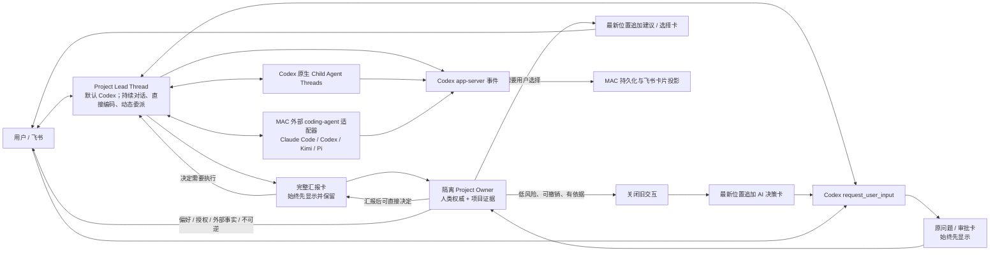

# MAC 架构

用户可观察的命令、卡片和状态语义以 [interaction-spec.md](interaction-spec.md) 为实施与验收基线；
本文只说明支撑这些行为的技术边界。

## 结论

MAC 的执行内核是一个持久 Project Lead Thread，不再另设 Coordinator Agent，也不再用状态机
预先规定需求、架构、编码、测试和返工阶段。Project Lead runtime 是稳定接口，当前注册并默认
使用 Codex adapter；项目执行循环不直接依赖 Codex 的构造方式。

Root Agent 是普通的完整 coding agent：它可以直接读取、修改和运行当前项目，也可以按
Codex 原生规则调用 `spawn_agent`、`send_message`、`followup_task`、`interrupt_agent`、
`wait_agent` 和 `list_agents`。何时自己完成、何时委派、是否并行，都由同一 Root Thread
根据当前任务动态决定。

## 源码基线

实现固定对照 OpenAI Codex `rust-v0.144.1`，提交
`44918ea10c0f99151c6710411b4322c2f5c96bea`：

- `core/src/session/turn.rs`：同一 turn 内的模型—工具循环；
- `core/src/tools/handlers/multi_agents_v2/`：原生多 Agent 工具；
- `core/src/agent/control.rs`：Agent thread、消息、打断与状态；
- `core/src/agent/role.rs`：可选角色配置，不是固定流程；
- `app-server` 的 `thread/start`、`thread/resume`、`turn/start`、`turn/steer`、
  `turn/interrupt` 和事件协议；
- `item/tool/requestUserInput`：Root Agent 的原生用户提问协议。

MAC 不重新实现以上控制语义。升级 Codex 版本时先更新源码映射和协议测试，再升级运行时。

## 组件边界

源码按以下阅读顺序理解；目录分层只表达宿主职责，不规定 Agent 的工作阶段：

| 入口 / 模块 | 负责 | 不负责 |
|---|---|---|
| `api/main.py`、`feishu/handlers.py` | 应用组合、真人消息和显式命令入口 | 推测自然语言意图、替 Agent 规划任务 |
| `core/root_agent.py` | 持久 thread 的宿主生命周期、原生交互和结果交付 | Provider 的模型 / 工具执行循环 |
| `agents/root_runtime.py`、`agents/kimi_runtime.py` | 统一生命周期接口及各 Provider 原生协议适配 | 项目治理决策、飞书 UI 布局 |
| `agents/runtime.py` | 显式调用的外部 CLI 桥接 | Project Lead 的执行调度和静默接管 |
| `core/root_progress.py` | 进程内进度模型、用量摘要和卡片展示 | 数据库访问、发送卡片、调度或停止执行 |
| `core/project_service.py`、`core/root_sessions.py` | 项目 / 公开历史 / outbox 和 thread 身份持久化 | 新建另一套 Agent 工作流 |
| `core/project_owner.py` | 独立 Owner 的公开上下文与用户权威边界 | 读源码、实现、技术评审或测试 |
| `core/notification_service.py`、`feishu/card.py` | outbox 投递与纯卡片构造 | 运行 Provider 或决定项目方向 |
| `utils/identifiers.py`、`utils/usage.py`、`utils/redaction.py` | 无宿主状态的 ID、用量和脱敏工具 | 数据库连接、会话或执行策略 |

进度展示可以独立于 runtime 和数据库测试。Root 仍负责时间线轮换、交互暂停和
outbox 投递；展示模块只接收已观察到的内存状态，不解释协议或触发副作用。
旧的 Root 私有展示入口和 `project_service.generate_id` 暂保留导入兼容，不复制实现。

| 组件 | 责任 |
|---|---|
| Project Lead runtime | 统一提供 thread 创建/续接、turn、steer、interrupt、压缩和关闭能力；具体 provider 由项目持久配置和注册表选择 |
| Codex Project Lead adapter | 当前默认实现；透明传输 app-server thread/turn/event/server-request，不解释业务阶段 |
| Isolated Project Owner | 每次使用独立临时 Thread；先核对本轮真人指令、ProjectPolicy、用户策略和未完成承诺，再把执行汇报与项目历史作为证据，判断能否代答、纠正方向或推动用户结果；不读源码，不承担技术 Review/Test，不规划实现、不编码、不调度具体工具 |
| ProjectService | 保存项目、ProjectHistoryRound、Root thread identity、用户规则、Owner 决定、问题、通知、成本和展示投影 |
| Feishu adapter | 把用户消息 steer 到活跃 turn，或启动新 turn；把原生问题和事件渲染为卡片 |
| External agent adapter | 把 Claude Code、Codex、Kimi、Pi 等后端包装成 Root Agent 可调用的额外执行工具 |
| Runtime/hosting | 单一受管服务进程、服务地址、日志、计费与恢复 |

Owner 有两个边界清晰的观察点：Root 通过原生协议提出问题或审批时先尝试代答；完整结果已经展示后，
审阅目标差距和是否继续推动。两者都使用独立临时 Thread，不进入 Root 的执行上下文。普通消息不先经过
Owner；Root 只按需读取现有治理记录投影出的精简结果契约。

每次 Owner 判断实际看到的公开上下文，以及用户随后提交的明确选择，都会写入项目事件日志。选择记录保留问题、可见选项、最终答案、选择人和来源，便于后续分析用户的选择方向；它仍是带上下文的历史证据，不会自动变成硬规则。

Root 通过 Codex 原生 `request_user_input` 表达执行中发现的实质疑问；MAC 先投影原问题卡，再由独立 Owner 判断能否
依据已有原则代答。只有不同理解会实质改变结果含义、可信度、范围或验收口径时才询问用户，普通实现
选择由 Root 自行处理。MAC 不据关键词触发咨询，也不把它扩展成 Coordinator、额外动态协议或状态机。

不存在以下组件：

- Coordinator Agent；
- 需求/架构/Spec/Coder/Tester/Reviewer 固定流水线；
- REWORK 状态和失败类型路由器；
- MAC 自己实现的 spawn/wait/followup 协议；
- 根据关键词或“任务复杂度”选择流程的逻辑。

## Project Lead provider 边界

- `ProjectLeadRuntime` 是 MAC 执行循环依赖的唯一接口，统一 thread 创建/续接、turn、steer、
  interrupt、上下文压缩、动态工具绑定和 transport 关闭。
- `CodexAppServerThread` 继承该接口并保留 Codex 官方 app-server 协议；Codex 特有配置只存在于
  adapter 的构造边界，不进入通用执行循环。
- `ProjectLeadRuntimeRegistry` 根据 `RootAgentSession.provider` 创建实现。新项目使用
  `PROJECT_LEAD_PROVIDER` 的默认值，当前为 `codex`；已有项目继续使用自己持久化的 provider，
  服务重启不能静默换后端或丢失 thread。
- 接入新的 Project Lead 需要实现同一接口并在应用组合层注册；不能为它复制 Root 工作流、增加
  关键词路由或在 adapter 内静默 fallback。provider 的原生事件与审批必须由 adapter 映射到 MAC 的
  公共事件和交互边界。
- 用户明确固定项目执行助手时，可在项目 context 设置 `execution_provider`。该项目的
  新 Lead 会话、独立 Owner 和外部 CLI 目录/调用均限制到这一 provider，且禁用自动跨 provider
  故障接管；未设置的项目仍沿用现有配置。已有会话必须先确认旧 runtime 及写入子进程停止，
  显式归档接管记录并清除旧 provider 的 native thread ID，不能把旧 ID 交给另一 provider 续接。

### 用户授权的故障接管

- `PROJECT_LEAD_FAILOVER_PROVIDER=kimi_code` 显式启用一次 Codex → Kimi 接管，默认留空。
  一次指每个 Codex 执行周期；用户明确切回 Codex 后，旧接管记录归档，不阻挡新的故障接管。
  同一开关也覆盖独立 Owner 审阅：初始化或模型调用超时、连接失败、原生重试耗尽时，
  确认旧进程停止后，由 Kimi 在独立临时会话接续本次审阅，并通过 outbox 公开通知。
  Kimi Owner 禁用内置编码工具、子 Agent 和全局 MCP，仅开放同一组只读管理工具；
  输出仍须通过同一 JSON Schema 和人类来源/授权校验。格式或业务校验失败不触发换助手。
  Codex 原生重试耗尽、进程/协议故障、明确的上游不可用错误或模型连续静默才触发；
  取消、一般任务失败、等待审批和仍在执行的工具不触发。静默阈值由
  `PROJECT_LEAD_SILENCE_TIMEOUT_SECONDS` 配置，默认 300 秒。
- 宿主先关闭旧 provider 及其进程树，无法确认停止则中止接管，避免两个助手同时写入。
  随后持久化 `RootAgentSession.provider_handoff`，记录来源、原因、新 UUID 和本项目最近
  5 轮公开指令/已送达报告；不复制隐藏推理、工具原始输出或其他项目内容。Kimi 先核实
  工作区与完成状态，不重复已完成的外部或不可逆操作。
- `KimiWireThread` 使用 Kimi CLI 原生 Wire 1.3、持久 session、工具、steer/cancel、审批和
  提问能力；不启用 `--yolo`。接管通知和最终答案走 outbox，答案发送失败只补发已保存结果。
  服务重启复用同一 Kimi UUID；接管后的项目继续使用 Kimi，不自动切回或循环切换。
- 此能力覆盖 Project Lead provider 故障，不替代 MAC 宿主的进程监护，也不保证全局网络故障
  时备用模型可用。备用失败原样展示；Project Owner 仍使用其独立后端。

## 生命周期

Project 只表达长期项目关系：`active / paused / cancelled`。一次 Root turn 结束表示“本轮
完成并可继续对话”，不把项目变成无法迭代的终态。

执行姿态只有：

- `running`：Root turn 或原生 Child Agent 正在工作；
- `owner_reviewing`：原问题卡已经展示，隔离的 Project Owner 正在判断是否能代答；用户仍可
  直接选择，先完成的有效回答生效；
- `waiting_user`：Codex 原生 `request_user_input` 正在等待答案；
- `waiting_external`：明确等待系统外部事件；
- `idle`：当前没有运行中的 turn，随时可继续。

飞书卡片直接投影 app-server 事件和以上持久状态，不维护第二份展示状态。

活跃 Turn 的 provider transport 与拥有该 Turn 的 `RootAgentEngine` 一起登记在进程内 Root handle
中。飞书/API 创建的短生命周期 facade 只负责把 steer 转交给该 handle。新的真人消息到达后，
拥有进度状态的引擎先冻结旧进度卡并轮换展示 segment；native `turn/steer` 成功后在时间线
最新位置新发进度卡并追加“已收到本轮补充”。Provider 仍可使用同一 Turn，但旧卡不得继续更新。
若 native turn 已越过边界并拒绝 steer，facade 改为调度下一 Turn，旧卡同样保持冻结。

## 会话与上下文

- 一个项目对应一个持久 Root thread id；每条项目消息进入或 steer 到该 thread。
- 服务进程内复用同一个 app-server client 和已连接的 Root thread；turn 结束只释放本轮状态，
  不重复启动进程或回放历史。服务重启时才使用持久 thread id 恢复。
- Codex 自己负责 rollout、历史截断、compaction 和 Child Agent `fork_turns`。MAC 在创建和
  恢复 thread 时传入相同的 8 万 Token 自动压缩配置，用户原文直接进入原生 turn；宿主不在
  turn 前另行启动或等待手动压缩，也不读取、重写或自行摘要对话历史。压缩 item 完成不等于
  用户 turn 完成；成功、失败和中断都以原生 `turn/completed` 为准。
- 一轮累计 Token 会在每次工具往返时重复计算并大量命中缓存，只用于用量展示；上下文大小
  展示使用 app-server 的 `tokenUsage.last.inputTokens`，不得拿累计输入误判会话长度或触发
  宿主维护。原生压缩用量计入本轮累计差值一次。
- MAC 不把工具日志、Child Agent 全文结果或历史测试输出重新拼进下一轮 Prompt。
- 默认始终恢复同一 thread。只有用户显式发送 `/new`（兼容 `/newthread`）时，MAC 才调用原生
  `thread/start` 并替换项目绑定的 thread id；项目和目录保留，旧历史不 fork、不注入新会话。
- 项目目录是 Root Agent 的 cwd 和写入范围；workspace-write 下仍可按 Codex 原生权限读取
  相关参考目录。
- Root 使用 `approvalPolicy=on-request`。`.git` 等 Codex 默认保护的元数据通过原生命令、文件或
  权限审批获得临时授权，MAC 不复制沙箱策略，也不使用临时 Git 目录绕过它。
- 项目中的 `AGENTS.md`、skills、工具和 Codex 用户配置按 Codex 原生加载机制生效。

## 用户交互

- Root Agent 是唯一智能对话身份，但不是一个特殊的 Coordinator 类型。
- 系统能读取、推导或验证的信息由 Agent 自己取得。
- 只有偏好、授权或系统无法取得的外部事实才询问用户。
- `request_user_input` 始终先投影原问题/审批卡，再由隔离执行的 Project Owner 评估。只有依据
  充分、风险低且可撤销的选择才能由 AI 代答；偏好、授权、凭证、真实费用、外部事实和不可逆操作
  仍交给用户。
- AI 代答时，必须关闭原问题/审批交互，把决定、依据、影响和调整入口作为后来事件追加在时间线
  最新位置；不得将选择和提交状态补写回更早的卡片。原卡无法撤回时保持历史内容不变，持久状态
  负责拒绝迟到回调。
- 每份完整 Root 结果汇报成功展示后统一触发一次 Owner 审阅。长汇报只审阅一次；Owner 有充分依据
  直接决定时，把决定追加在同一结果卡；需要用户选择时，先结束结果卡，再在时间线最新位置发送
  可操作的建议/选择卡。需要继续执行时只把已经公开的决定送回同一 Root Thread。无未决事项时
  不生成选择卡，也不启动额外 Turn。
- 汇报送达后先持久化 Owner 审阅任务，再释放项目执行锁；Owner 的独立模型调用不得阻塞用户下一轮
  消息。最后一张汇报卡原地投影审阅中/已审阅/失败状态；无需继续执行的具体意见留在原汇报卡。服务重启时只恢复
  未完成的审阅任务，不重放已经完成的 Root Turn 或结果卡。若审阅完成前已有更新轮次，旧审阅
  标记为被后续消息接管，不得再修改 Owner 状态、发决定或推动执行。
- Owner 开关按 Project 持久化。关闭时不创建新的汇报审阅任务，也不参与原生问题或审批；已有问题
  仍按原协议直接等待用户。已经在执行的 Owner 结果若在关闭后返回，只能作废，不能晚到发卡或改状态。
- Owner 对方向存在有意义但低把握的建议时，不生成纯文字建议；结构化返回至少一项具体建议，有真实取舍时返回实际存在的互斥选项，由同一张
  选择卡承载；提交前可在原卡暂存选项，提交后关闭原卡，在时间线最新位置追加选择结果，
  并将其作为新用户指令交给 Root。
- Project Owner 不是 Root 动态工具、Coordinator 或第二条工作流。每次判断使用独立临时 Thread，
  不读取 Root 隐藏对话、reasoning、工具日志或其他项目内容；进程 cwd 位于项目目录之外。它可以
  读取已成功送达用户的结果/决策卡、同一用户明确选择的带时间历史和白名单只读管理工具；Owner
  不读取项目源码，也不代替 Reviewer、Tester 或 Verifier 做技术判断。它只能
  通过 Codex 原生 turn-scoped `outputSchema` 一次返回结构化决定；不得用终态提交工具触发一轮
  只用于确认工具结果的额外模型调用。
- Project Owner 的身份属于用户层。用户原始输入和链接可跨项目进入只读证据档案，但默认上下文只放
  精炼后的用户策略；原文由 `search_user_history` 按需检索，用户原文中确实出现过的网页链接可由
  `read_user_link` 白名单只读工具查看内容，不能任意浏览。每条策略保存内容、全局/项目范围、
  硬规则/默认倾向、置信度、重复证据数、用户原话证据、时间、来源 Project 和生效状态。Project 范围和来源 Project 是
  两个独立字段，因此全局策略跨项目使用时也不会丢失证据出处。项目的一次性选择只进决定账本，
  不上升为长期偏好；同一判断至少由两个真实选择引用支持后，才可形成 `repeated_choice` 记忆。
- `ProjectPolicy` 不复制具体命令或一次性选择，只保存用户明确长期表达的 `explicit` 原则，或至少两处
  独立真人来源支持的 `inferred` 原则。每条记录保留全部来源原文、时间和相邻上下文；`inferred` 只能
  支持建议和低风险可撤销推进，不能代替用户授权。用户纠正旧原则时只能精确引用被替换记录；旧格式
  记录保留审计但不进入活跃原则上下文。
- 本机历史偏好可通过 `python scripts/import_owner_preferences.py --apply` 离线初始化。脚本扫描
  Codex、Claude Code、Kimi Code、Pi、ZCode 的真人 user 记录以及 `AGENTS.md`、`AGENT.md`、
  `CLAUDE.md`，结构化排除 SDK 任务合同、工具回传和系统包装，再由隔离 Owner 分批提炼并与已有
  策略做语义去重/冲突审计。每条新增记忆仍保留逐字证据和来源；默认不写库，只有 `--apply` 生效。
  `--archive-only --apply` 只归档去重后的真人原始输入和链接，不运行偏好推断，适合先建立完整可检索
  历史再渐进学习。
- 历史归档单位是有来源的真人事件，而不是去重后的孤立句子。每条事件保留 provider、Session、Turn、
  Project、用户原话，以及该 Turn 前后的用户可见问题/结果；前后内容只用于解释“继续”“1”“不是这个”
  等指代，永远不能成为用户偏好证据。相同文字发生在不同 Turn 时必须分别保留，只有 provider 明确重放
  同一消息/Turn 才能去重。飞书自然语言消息和卡片选择使用同一档案，其中选择必须连同原问题保存。
- MAC 自己启动的 Codex Thread 不能按协议里的 `user_message` 直接导入，因为其中同时包含飞书真人
  输入和 Owner 续推等系统传输消息。此类 Thread 由 `session_meta.originator=mac-system` 排除；真人
  飞书输入只从 `ProjectHistoryRound.user_instructions` 的显式来源读取，避免把 Agent 自己的话学成用户偏好。
- Owner 不维护独立目标状态，也不驱动后台定时复审。Owner 的判断依据是带来源、时间
  和原文上下文的人类规则，加上项目历史和未完成公开决定；无法可靠解决冲突时询问用户。
- 项目决定、承诺和结果引用按 Project 隔离。ProjectHistoryRound 从用户指令开始，在同一 Turn 接受
  steer 补充，并在汇报成功展示后记录最终结果；`/new` 只替换 provider Thread，不删除项目历史。
  Owner 的输入先按权威层提供本轮真人指令、ProjectPolicy、全部生效用户策略和未完成
  承诺，再按证据层提供当前与最近 5 轮的结果级摘要；完整汇报和更早轮次可通过 `read_project_history` 查看，历史真人
  指令可通过 `read_user_authority_history` 单独读取。汇报是待审查声明，不得覆盖目标或人类权威记录。
- 汇报审阅同时接收请求来源。只有 `human` 来源的本轮用户原话是新增范围和授权证据；
  `project_owner` 和 `system_recovery` 产生的执行文字不得被再次解释为用户授权。旧决定和历史证据不能让
  状态查询、解释或只读请求意外恢复历史工作；继续执行必须与本轮请求和已展示汇报一致。
- 同一 Root Turn 内已经展示并生效的问题/审批决定属于下一份结果审阅的必要上下文；Owner 不得
  对同一事项重复决定。每轮汇报后的 Owner 都至少给出一条具体意见；只有 `continue_execution=true`
  才会交回 Root 执行，不需要继续时明确建议保持现状、关注点或下一次最值得做的事。
- 汇报决定交回 Root 时可以携带内部关联 ID 用于去重和定位，但该 ID 不表达父子决定，也不把旧 Owner
  判断继承为用户权威。每次后续审阅都重新从最新真人原话、有效用户原则和项目历史判断下一步；执行结果
  作为新事件追加，不回写原决定卡。
- 用户和 Owner 可能同时处理同一问题。后台以持久化的原子认领保证第一个有效回答生效；Owner
  应用失败时释放认领，原问题卡继续等待用户；答案已经原子落库后，卡片发送失败由 outbox 重试，
  不得回滚已返回 Codex 的答案，也不得在落库前显示假成功。
- `ProjectOwnerReview` 保存决定、依据、影响、是否续推、用户偏好更新和项目原则更新；
  `ProjectOwnerState` 仅保留为旧数据库迁移输入，新运行路径不再写入，避免同一状态存在两份权威副本。
- Owner 执行后端通过 provider registry 构造；当前默认注册 Codex 实现，但治理协议、数据模型和卡片不
  依赖 Codex 类型。新增后端应实现同一隔离、只读、结构化输出契约，而不是改 Owner 业务流程。
- Owner 默认预载当前真人指令、全部 ProjectPolicy、未完成承诺、全部生效用户策略，
  以及当前/最近 5 轮的结果摘要、三条近期决定和最近 5 条跨项目真人选择；用户策略默认只携带结论、
  适用范围、置信度和来源引用。完整技术汇报、偏好原始证据、
  更早选择、原始用户历史与链接按需通过只读管理
  工具读取。Owner 对 Root 只表达用户价值、优先级、结果和边界，不输出文件、命令、协议字段或排查
  清单；技术不确定性只要求 Root 补足可用性证据。Codex
  隔离 Thread 的固定系统上下文仍会计入输入
  Token，不能为了伪造缓存命中而共享 Owner 与执行 Thread；费用卡应如实显示这部分后端成本。
- 用户问题在原 turn 中等待飞书答案；回答后继续同一个 turn，不创建“恢复阶段”。
- 用户在运行中发送新消息时使用 `turn/steer`；展示层同时冻结旧进度卡，并在消息之后创建新的
  当前进度卡。Root idle 或 native steer 拒绝时开始下一 turn；是否延续 Turn 不影响卡片轮换。
- `waiting_user` 仍是活跃 Turn。未引用问题卡的新消息可以 steer 给 Root，但不等于
  `request_user_input` 响应：持久 `QuestionInteraction` 保持 pending，用户消息本身保留补充事实，
  原问题卡不被回写。回复单问题卡或提交卡片才走原生 request response。
- 飞书收到消息后立即在用户原消息上添加回应并创建当前进度卡；只要没有新的用户可见事件插入，
  最新卡可以持续投影准备、模型、工具、Child Agent、外部 Provider、等待和终态。出现真人消息、
  Owner 决定、问题或审批后必须轮换新卡，不能再更新时间线上更早的卡，也不能用伪造百分比表示进度。
- 长时间没有新事件时，进度卡显示已等待时间和最后真实活动时间。服务重启无法重新附着已经
  失去 app-server 进程的 active turn：MAC 先把旧问题和旧 turn 如实标成中断，再在同一个持久
  Root Thread 新开恢复 turn，带入原用户请求并要求先检查现状、避免重复不可逆动作。已经完成、
  仅在结果投递或 Owner 后处理阶段被关机的 turn 不得重跑。
- 面向用户的输出全部使用卡片。进度可以充分，但不得展示内部 task path、thread id、
  协议字段和原始工具日志。
- 飞书回复关系是显式路由信号：`parent_id` 通过 CardProjection 的 provider message ID 定位
  Project 和卡片类型。运行中进度卡回复 steer 到原 Turn，已完成卡片回复进入该 Project 当前
  Thread 的新 Turn；只携带卡片公开摘要，不恢复旧 Thread 或重放完整卡片内容。
- Project 是唯一导航边界，固定拥有工作目录和当前 Root Thread。`/open`（兼容 `/bind`）
  立即打开已有目录对应的 Project 并设为当前项目；同一用户在同一聊天已有同目录 Project 时
  恢复它，否则创建一个新的 Project。不同聊天不会因目录相同而共享 Project 或 Thread。
  不存在独立的“下一次新建项目目录”状态。
- `/new` 只替换当前 Project 的 Root Thread，项目和工作目录保持不变；普通消息只能进入当前
  明确选中的 Project，不回退到用户最近更新的其他项目。
- 进度卡保存 Agent 公开 commentary 形成的大步骤历史，以及当前大步骤中的真实工具、验证、
  Child Agent 和外部 provider 小步骤历史。它是 app-server 事件投影，不是固定研发状态机。
- 同一事件投影按渐进披露生成一个视图：蓝、绿、红三种卡片颜色表达运行、完成和失败；卡片
  上方用默认展开的“执行步骤”呈现大步骤，运行中附带当前小步骤；溢出历史进入可点击的“···”
  折叠区域，完成后只保留大步骤。当前执行者和耗时位于步骤下方；真实执行链、并行状态、实际
  Agent、模型、选择原因及分项用量位于下方默认折叠的详情中。并行关系来自重叠的真实执行
  事件，不能把同时运行的 Agent 排成伪串行流程。

## 外部 provider 选择

- `run_external_agent` 的 `provider` 由 Root Agent 在调用时显式选择，runtime 严格执行该
  provider，不静默 fallback。
- 两个以上互不依赖的外部 CLI 任务可由 Root 一次调用 `run_external_agents` 并发执行；该工具
  只是批量版 provider 桥，不判断意图、不固定角色，也不替 Root 决定任务或 provider。单个任务
  仍使用 `run_external_agent`。
- `list_external_agents` 向 Root 实时提供启用状态、非敏感配置说明，以及最近执行的进程完成率、平均耗时、平均
  工具调用数和已报告成本；这些指标只说明执行后端是否正常返回，不等于产物语义验收通过，
  且不暴露其他项目的任务内容。
- 用户显式指定 provider 时优先遵从；否则 Root 根据任务和上述证据动态决定，不使用关键词
  路由，也不按固定角色绑定 provider。
- `/agents` 只读取运行时注册表、非敏感配置和近期进程指标，显示实际可用、未启用或不可用；
  它不参与自然语言路由，也不触发 provider。
- 每次调用必须提供简短的用户可见选择理由，跟随用户当前语言且不含内部路由或协议黑话。
  飞书进度卡显示 provider、选择理由和外部 CLI 的真实活动状态。
- Codex 原生 Child Agent 角色与外部 provider 是两个维度：角色描述任务责任，provider 描述
  外部执行后端。普通委派优先使用 Codex 原生 Child Agent，只有独立 CLI 执行确有价值时才
  使用外部 provider。
- 各 provider 的模型缓存彼此隔离。MAC 不实现跨模型缓存层，也不把 Root 全量历史复制给外部
  CLI；Root 直接处理简单任务，原生相关子任务续接同一 Child Thread，外部 CLI 每次仅接收
  当前调用的最小充分上下文。进度卡按执行者分别投影 provider 原生 usage，未报告项不进入
  可核验合计。

## 动态工具与可配置角色

- 外部 CLI 作为 app-server `thread/start` 的 dynamic tool 注入；Codex 的 `thread/resume`
  不接受新的 dynamic tool 定义，因此不能假设旧 thread 会自动获得新 schema。
- Dynamic tool 的名称和 schema 保持稳定；provider 列表和运行指标通过只读工具实时获取，不写入
  schema。旧 Thread 始终优先续接其原合同，配置变化不得静默替换 Thread 或丢失项目对话；确需
  升级工具合同时只能由用户显式执行 `/new`。
- `analyst`、`reviewer` 等可选角色通过 Codex 原生 `[agents.<role>]` 配置提供，仅描述委派时
  的责任和边界，不组成固定流水线；内置 worker 继续承担普通实现任务。

## 服务托管与恢复

- 本机服务由一个 launchd job 持有；启动脚本只安装、拉起并核对真实监听 PID，禁止同时
  存在 reload 进程、旧后台进程和新服务进程。
- 正常关闭会将正在执行的 native turn 标记为“被服务重启中止”。每次启动同时对账 Project、
  RootAgentSession、审批和问题交互，释放无人持有的 `running`、`owner_reviewing`、
  `waiting_user`、`resolving`
  状态；原进度卡可结束同一未完成执行事件，已失效问题卡应关闭，恢复结果在最新位置展示，
  避免把重启这一较晚事实写回旧问题卡。
- 恢复不是伪造原 turn 仍然存活，也不静默重放工具。只要持久记录中存在原用户请求和 Root
  Thread id，启动后会自动调度一轮安全续接；缺少可靠请求时保持空闲并明确中断，不猜测任务。

## MAC 扩展边界

MAC 只增加 Codex 产品本身没有的能力：

1. 飞书移动端交互与卡片状态同步；
2. 项目目录绑定和项目切换；
3. 外部 coding-agent 后端；
4. 本地服务托管、成本和 profiling；
5. 可靠通知、幂等和重启恢复。

这些扩展不得改变 Codex 的 turn loop、多 Agent 工具语义、上下文所有权和 Root Agent 权限。

## 不变量

1. 用户消息不会先被编译成固定阶段或 DAG。
2. Root Agent 第一轮就拥有正常 Codex coding 权限。
3. Codex 原生多 Agent 工具由 Codex 执行，MAC 只消费事件。
4. 同一 app-server request 只产生一次持久副作用；同一未结束事件只维护一张可更新卡片，
   后续提交和决定必须追加新事件卡。
5. AI 决策只响应原生 `request_user_input` 或已经完整送达的 Root 结果汇报。问题答案必须先以
   同一原子提交协议持久化，再关闭原问题卡并追加结果卡；原生审批的 Owner 说明可在提交前合并在
   该卡，普通问题与汇报
   决定可按需追加决策卡。卡片发送失败由 outbox 重试，绝不能
   在答案落库前显示“已应用”。Owner 不能改变 Root tool profile 或替代 Root 控制循环。
6. `request_user_input` 的答案只返回仍存活的原生请求；重启丢失内存请求时必须将旧交互标记为
   已中断，不得伪装成原 Turn 已经收到答案。
7. 一轮结束后项目保持可继续迭代。
8. 外部 Agent 后端必须适配相同的任务、消息、打断、状态和成本语义，不能反向引入阶段流。
9. 不为单个用户措辞、项目名或错误文本增加关键词分支。
10. 同一服务进程内相邻 turn 复用 app-server；动态工具调用契约改变时才迁移 Root thread。
11. 每个 Root turn 记录官方协议边界的相对耗时和累计 token 计数差值；没有 Provider 报价时
    费用保持未知，不用 `$0` 代替。

## 验证

修改执行内核后必须依次通过：

1. Root runtime 协议测试；
2. API、持久化和飞书投影测试；
3. 真实 Codex app-server 项目回合；
4. 真实飞书私聊界面测试；
5. 通过 MAC 对已有项目执行修改、调试和继续迭代；
6. 个人 Agent 项目的身份、风格、记忆、few-shot、skills、工具、发送文件和可访问性黑盒。
