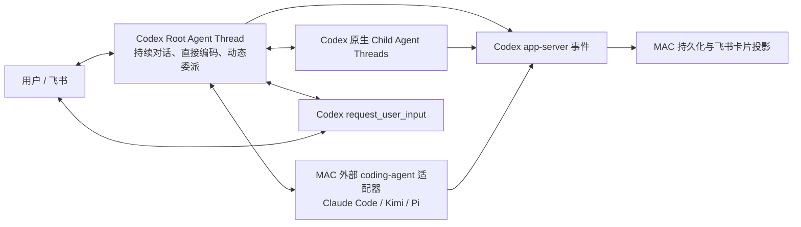

# MAC 架构

## 结论

MAC 的执行内核就是一个持久 Codex Root Agent Thread，不再另设 Coordinator Agent，
也不再用状态机预先规定需求、架构、编码、测试和返工阶段。

Root Agent 是普通的完整 coding agent：它可以直接读取、修改和运行当前项目，也可以按
Codex 原生规则调用 `spawn_agent`、`send_message`、`followup_task`、`interrupt_agent`、
`wait_agent` 和 `list_agents`。何时自己完成、何时委派、是否并行，都由同一 Root Thread
根据当前任务动态决定。

## 源码基线

实现固定对照 OpenAI Codex `rust-v0.144.1`，提交
`44918ea10c0f99151c6710411b4322c2f5c96bea`：

- `core/src/session/turn.rs`：同一 turn 内的模型—工具循环；
- `core/src/tools/handlers/multi_agents_v2/`：原生多 Agent 工具；
- `core/src/agent/control.rs`：Agent thread、消息、打断与状态；
- `core/src/agent/role.rs`：可选角色配置，不是固定流程；
- `app-server` 的 `thread/start`、`thread/resume`、`turn/start`、`turn/steer`、
  `turn/interrupt` 和事件协议；
- `item/tool/requestUserInput`：Root Agent 的原生用户提问协议。

MAC 不重新实现以上控制语义。升级 Codex 版本时先更新源码映射和协议测试，再升级运行时。

## 组件边界

| 组件 | 责任 |
|---|---|
| Codex Root Thread | 理解用户、直接完成工程工作、动态调用工具和 Child Agent、维护对话上下文 |
| Codex app-server client | 透明传输 thread/turn/event/server-request，不解释业务阶段 |
| ProjectService | 保存项目、Root thread identity、问题、通知、成本和展示投影 |
| Feishu adapter | 把用户消息 steer 到活跃 turn，或启动新 turn；把原生问题和事件渲染为卡片 |
| External agent adapter | 把 Claude Code、Kimi、Pi 等后端包装成 Root Agent 可调用的额外执行工具 |
| Runtime/hosting | 进程、服务地址、日志、计费与恢复 |

不存在以下组件：

- Coordinator Agent；
- 需求/架构/Spec/Coder/Tester/Reviewer 固定流水线；
- REWORK 状态和失败类型路由器；
- MAC 自己实现的 spawn/wait/followup 协议；
- 根据关键词或“任务复杂度”选择流程的逻辑。

## 生命周期

Project 只表达长期项目关系：`active / paused / cancelled`。一次 Root turn 结束表示“本轮
完成并可继续对话”，不把项目变成无法迭代的终态。

执行姿态只有：

- `running`：Root turn 或原生 Child Agent 正在工作；
- `waiting_user`：Codex 原生 `request_user_input` 正在等待答案；
- `waiting_external`：明确等待系统外部事件；
- `idle`：当前没有运行中的 turn，随时可继续。

飞书卡片直接投影 app-server 事件和以上持久状态，不维护第二份展示状态。

## 会话与上下文

- 一个项目对应一个持久 Root thread id；每条项目消息进入或 steer 到该 thread。
- Codex 自己负责 rollout、历史截断、compaction 和 Child Agent `fork_turns`。
- MAC 不把工具日志、Child Agent 全文结果或历史测试输出重新拼进下一轮 Prompt。
- 项目目录是 Root Agent 的 cwd 和写入范围；workspace-write 下仍可按 Codex 原生权限读取
  相关参考目录。
- 项目中的 `AGENTS.md`、skills、工具和 Codex 用户配置按 Codex 原生加载机制生效。

## 用户交互

- Root Agent 是唯一智能对话身份，但不是一个特殊的 Coordinator 类型。
- 系统能读取、推导或验证的信息由 Agent 自己取得。
- 只有偏好、授权或系统无法取得的外部事实才询问用户。
- `request_user_input` 在原 turn 中等待飞书答案；回答后继续同一个 turn，不创建“恢复阶段”。
- 用户在运行中发送新消息时使用 `turn/steer`；Root idle 时开始下一 turn。
- 面向用户的输出全部使用卡片。进度可以充分，但不得展示内部 task path、thread id、
  协议字段和原始工具日志。

## MAC 扩展边界

MAC 只增加 Codex 产品本身没有的能力：

1. 飞书移动端交互与卡片状态同步；
2. 项目目录绑定和项目切换；
3. 外部 coding-agent 后端；
4. 本地服务托管、成本和 profiling；
5. 可靠通知、幂等和重启恢复。

这些扩展不得改变 Codex 的 turn loop、多 Agent 工具语义、上下文所有权和 Root Agent 权限。

## 不变量

1. 用户消息不会先被编译成固定阶段或 DAG。
2. Root Agent 第一轮就拥有正常 Codex coding 权限。
3. Codex 原生多 Agent 工具由 Codex 执行，MAC 只消费事件。
4. 同一 app-server request 只产生一次持久副作用和一张可更新卡片。
5. `request_user_input` 的答案返回原生请求；重启丢失内存请求时，答案作为下一 turn 的
   明确用户输入恢复。
6. 一轮结束后项目保持可继续迭代。
7. 外部 Agent 后端必须适配相同的任务、消息、打断、状态和成本语义，不能反向引入阶段流。
8. 不为单个用户措辞、项目名或错误文本增加关键词分支。

## 验证

修改执行内核后必须依次通过：

1. Root runtime 协议测试；
2. API、持久化和飞书投影测试；
3. 真实 Codex app-server 项目回合；
4. 真实飞书私聊界面测试；
5. 通过 MAC 对已有项目执行修改、调试和继续迭代；
6. 个人 Agent 项目的身份、风格、记忆、few-shot、skills、工具、发送文件和可访问性黑盒。
