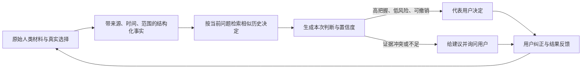
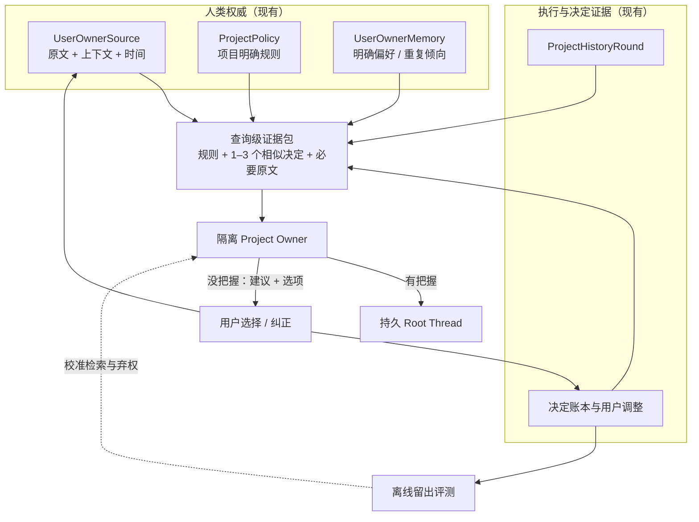

# 数字人分身如何“蒸馏一个人”：对 MAC Project Owner 的启发

> 调研日期：2026-08-16
>
> 目标：研究代表性的数字人、个人 AI、长期记忆和人格模拟项目，判断哪些机制值得 MAC Project Owner 吸收。
>
> 结论先行：Owner 应成为“可审计、会弃权的用户决策代理”，不是会模仿口吻的完整人格分身。

范围说明：数字人产品没有封闭的“全部项目”清单，且大量产品只是在复用同一种头像或 RAG 方案。本文以能从论文、官方代码或官方文档核对蒸馏机制的项目为主，覆盖认知/决策、长期记忆、访谈传记、声音和视频形象五类；同机制产品不做无意义穷举。

## 1. 核心结论

数字人项目实际在复制三种不同的东西：

1. **人的知识、偏好和决策方式**：Stanford 1,000 人模拟、Second Me、Delphi、Personal AI、Character-LLM；与 Owner 直接相关。
2. **长期记忆和用户模型基础设施**：Letta/MemGPT、Mem0、Zep/Graphiti、Honcho；与 Owner 的证据组织和检索相关。
3. **声音、形象和表达表面**：HeyGen、Synthesia、Tavus、ElevenLabs、StoryFile、HereAfter；能提高“像本人”的感受，但几乎不能证明“会像本人一样决定”。

跨项目最可靠的蒸馏链路是：



对 MAC 最有价值的不是新增数据库、人格层级或训练流水线，而是四件事：

- 把**相似的历史决定**作为 Owner 决策的主要示例，而不只给抽象偏好。
- 明确区分**用户明说的规则、反复选择形成的倾向、仅供建议的假设**。
- 用用户过去真实选择建立**留出评测和弃权校准**，衡量 Owner 到底像不像用户。
- 把用户纠正沉淀为带原文的**反例和禁区**，精确替代错误推断。

这些改进可以复用现有 `UserOwnerSource`、`UserOwnerMemory`、`ProjectPolicy`、决定账本和只读历史工具，不需要另建“数字人子系统”。

这也不意味着削弱 Owner 的推动权。Owner 在充分理解用户当前意图、目标和边界时，应继续有权替用户确定业务方向、细化目标并推动 Root；重要方向证据不足或存在真实取舍时，才给出明确建议和可选方案与用户对齐。用户纠正后，新的人类原话必须压过 Owner 旧判断及其派生记忆。

## 2. 什么才算“把人蒸馏成数字人”

仅能回答用户文档里的事实，不等于复制了用户；模仿语气，也不等于能代表用户做决定。对 Owner 而言，蒸馏质量至少有四层：

| 层次 | 要复制的能力 | 典型证据 | Owner 是否需要 |
| --- | --- | --- | --- |
| 事实记忆 | 用户知道什么、项目发生过什么 | 原始消息、文档、选择记录 | 需要，但必须区分人类权威和执行证据 |
| 稳定偏好 | 用户长期偏好什么 | 明确规则、跨场景重复选择 | 需要 |
| 情境决策 | 用户在特定约束下会怎么权衡 | 问题、选项、上下文、最终选择 | 最需要 |
| 表达/形象 | 用户怎么说、长什么样、声音如何 | 文本、视频、音频 | Owner 基本不需要 |

因此，Owner 的目标不是构造一份笼统的“用户人格摘要”，而是：**在一个具体决策情境中，找出足够接近且仍然有效的人类证据；能推断就代答，不能推断就给出有方向的建议并让用户选择。**

## 3. 代表项目盘点

### 3.1 身份与决策分身

| 项目 | 如何采集一个人 | 如何形成分身 | 如何验证或纠正 | 对 Owner 的启发 |
| --- | --- | --- | --- | --- |
| [Stanford：Generative Agent Simulations of 1,000 People](https://arxiv.org/abs/2411.10109) / [代码](https://github.com/joonspk-research/genagents) | 对 1,052 人做约两小时半结构化访谈；固定问题之外根据回答追问 | 完整访谈原文加面向具体问题的专家反思；不是只用人口属性 | 在未参与建模的问卷和实验上，与本人两周后的自我复测比较；GSS 题上达到本人复测准确率的 85% | 丰富原始访谈优于人口标签；“反思”只是可重建的派生材料；必须用留出选择验证 |
| [Synthetic Personalities](https://arxiv.org/abs/2606.04592) | 使用同一个人的既有社会经济面板历史 | 比较叙事人格摘要与原始历史回答 | 500 人、183 个留出问题、210 万次回答；完整信息下原始对话历史在所有组合中优于叙事摘要；最佳准确率仍只有 78.8% | 原文和历史选择不能被人格摘要替代；信息再多也不应取消弃权 |
| [Second Me](https://github.com/mindverse/Second-Me) / [论文](https://arxiv.org/abs/2503.08102) | 导入个人写过、说过、想过的材料 | L0 原始数据、L1 自然语言记忆、L2 参数化记忆；合成训练数据，经 SFT、DPO 和自动评估得到个人模型 | Memory QA、Context Enhance、Context Critic 等自动指标；产品提供对齐等级和关键记忆管理 | 分层思想有用，但 MAC 已有等价分层；“为外部 Agent 补充用户上下文”和“批评不合用户意图的结果”与 Owner 接近 |
| [Delphi](https://www.delphi.ai/blog/the-clone-economy) / [Interview Mode](https://www.delphi.ai/blog/interview-mode) | 导入文章、视频、播客和动态数据；用采访补齐“你如何思考” | 分开建模知识、目的、说话方式和默认行为 | Readiness、引用追踪、对话回看、Purpose/Style 编辑和持续更新 | 被动历史与主动追问应互补；用户应能看到“从哪里学到、为什么这样答” |
| [Personal AI](https://www.personal.ai/memory) / [Memory Stack](https://product-docs.personal.ai/training-your-ai/memory-stack) | 消息、文档、文件和链接进入个人 Memory Stack | 个人语言模型学习事实、意见和表达方式 | 用户可增删、强化和回滚记忆；Personal Score 决定是否自动回复 | 可编辑、可回滚、可解释比“神秘地越来越懂你”重要；自动行动需要阈值 |
| [Character-LLM](https://arxiv.org/abs/2310.10158) | 角色档案、真实经历、情绪和关系 | 把经历重构为场景和多轮对话，约 1,000–2,000 个场景微调角色模型 | 多轮访谈评测记忆、人格、价值观、幻觉和稳定性；加入 protective experiences 防止角色声称不该知道的事情 | 反例与“不应该怎么决定”很重要；但用模型补写经历会制造细节，不能成为 Owner 权威 |
| [Generative Agents](https://arxiv.org/abs/2304.03442) | 连续记录 Agent 经历 | 记忆流按相关性、近期性、重要性检索，并生成高层反思用于计划 | 消融实验显示观察、反思、计划都影响可信度 | “事件→反思→按问题检索”有效；但 Agent 经历只能是执行证据，不能上升为用户规则 |
| [AI YOU](https://arxiv.org/abs/2607.10539) | 从连续对话更新人格证据 | 22 维人格、贝叶斯更新、共形预测、周期性 memory anchor | 报告不确定性覆盖率和 100 轮抗漂移表现 | 不确定性校准和抗漂移值得关注；固定 22 维人格、三层记忆不应直接照搬 |

### 3.2 长期记忆和用户模型

| 项目 | 核心机制 | 优点 | 对 Owner 的边界 |
| --- | --- | --- | --- |
| [Letta / MemGPT](https://arxiv.org/abs/2310.08560) / [Memory Blocks](https://docs.letta.com/guides/core-concepts/memory/memory-blocks) / [Context Hierarchy](https://docs.letta.com/guides/core-concepts/memory/context-hierarchy) | 小而常驻的 memory blocks、只读文件、按需检索的 archival memory，模拟操作系统的分层内存 | 解决“热上下文”和“冷档案”的成本问题；记忆块可以只读 | MAC 已有热层 `ProjectPolicy/UserOwnerMemory` 和冷层 `UserOwnerSource/ProjectHistoryRound`。不要再加可自由自改的 `human/persona` 大文本块，它会丢失来源和权威等级 |
| [Mem0](https://arxiv.org/abs/2504.19413) | 从对话动态抽取、合并、检索显著记忆；图变体保存关系 | 相比把全历史塞入上下文，更省 Token、延迟更低 | 通用“显著性”不足以判断用户授权；可借抽取和合并，不借单一记忆池 |
| [Zep / Graphiti](https://arxiv.org/abs/2501.13956) | 带时间的知识图谱，保留关系如何随时间变化 | 擅长处理新旧事实、关系和有效期 | MAC 当前的 `source_time + source_context + supersedes` 已覆盖最关键部分；没有评测证据前不引入图数据库 |
| [Honcho](https://honcho.dev/docs/v3/documentation/core-concepts/representation) / [Reasoning](https://honcho.dev/docs/v3/documentation/core-concepts/reasoning) | 从消息生成演绎、归纳、溯因三类结论；周期性短/长摘要；按观察者与被观察者区分 perspective | 明确承认用户模型含不同推断强度，并持续处理矛盾 | 很适合启发 Owner 的证据分级；但归纳和溯因只能帮助建议，不能成为新的用户授权或硬规则 |

### 3.3 访谈式、声音和形象分身

| 项目 | 复制了什么 | 蒸馏方式 | 对 Owner 的启发 |
| --- | --- | --- | --- |
| [StoryFile](https://life.storyfile.com/how-it-works) | 本人的视频回答 | 预先采访并录制问题；AI 只检索最匹配的原始视频，不生成新答案 | 高风险场景可退回“只引用用户真实说过的话”；忠实性有时比覆盖率重要 |
| [HereAfter AI](https://www.hereafter.ai/) | 本人的故事和声音 | 虚拟传记作者提问，记录人生经历、关系、性格和照片，之后用问答取回 | 结构化采访能补历史空白；个人材料必须允许导出、迁移和删除 |
| [HeyGen Digital Twin](https://help.heygen.com/en/articles/12089286-create-your-first-digital-twin-video-avatar-with-avatar-iv) | 外观、动作和声音 | 连续视频训练，另录本人同意视频 | 身份授权和来源验证是必要基础；视觉相似不等于决策相似 |
| [Synthesia Personal Avatars](https://docs.synthesia.io/docs/personal-avatars) | 外观、动作和声音 | 照片或 1–5 分钟连续视频、声音样本和实时同意 | 同上；采集质量比堆积低质量素材更重要 |
| [Tavus Replica](https://docs.tavus.io/sections/troubleshooting) | 视频形象和声音 | 训练前要求本人录制指定同意声明，再建立可用于对话视频的 replica | 对外代表用户前必须单独验证身份和同意，不能从“模型学会了”反推用户授权 |
| [ElevenLabs Professional Voice Cloning](https://elevenlabs.io/docs/eleven-creative/voices/voice-cloning/professional-voice-cloning) | 声音 | Instant 模式用少量样本条件化，Professional 模式用约 30–180 分钟、理想 1–3 小时语音训练专用模型，并验证声音所有权 | 能证明表达风格和身份需要独立验证；不能把“说得像用户”当成“决定符合用户” |

这类项目对 Owner 的直接技术价值较低。它们最重要的提醒是：**身份、同意、来源、可撤销性必须独立于模型能力存在；表面相似度不能替代行为准确率。**

## 4. 外部项目反复验证的共同规律

### 4.1 原始历史通常比人格摘要更可靠

Stanford 1,000 人模拟用长访谈原文，而不是只给人口属性；2026 年的 Synthetic Personalities 在完整信息条件下发现，原始历史回答稳定优于叙事人格摘要。原因是人格摘要会提前做一次不可逆压缩：条件、例外、时间和犹豫都容易消失。

对 Owner 的含义不是“把全历史塞进 Prompt”，而是：

- 原文必须完整、只读、可检索地保留；
- 抽象规则只负责快速定位，不替代原文；
- 遇到冲突、短回复、重要决定或低置信度时，回看相关原文及上下文；
- 每个决定引用真实来源，不能只写“根据用户偏好”。

### 4.2 决策示例比静态人格标签更接近真实用户

“用户追求简洁”很难直接回答“这次是保留兼容层，还是做一次迁移”。更有用的证据是：过去在什么约束下，用户面对哪些方案，选择了什么，之后是否纠正。

因此，Owner 的最小决策样本应是：

```text
decision_case = {
  question,
  options_or_tradeoff,
  project_context,
  applicable_constraints,
  user_choice,
  user_rationale_if_any,
  source_ref,
  source_time,
  later_correction_or_supersession
}
```

它不是新权威表；可以由现有问题卡、卡片选择、`ProjectDecision` 和 `UserOwnerSource` 在读取时投影得到。

### 4.3 派生理解必须有类型，不能伪装成用户原话

Honcho 把结论分成演绎、归纳和溯因；Character-LLM 用 protective experiences 约束模型不要声称不存在的知识。对 MAC，更合适的简化分级是：

| 级别 | 例子 | Owner 可以怎么用 |
| --- | --- | --- |
| 明确规则 | “架构和 Owner 逻辑都要简洁” | 在适用范围内作为权威规则 |
| 重复选择倾向 | 多次在可撤销方案中选择最小改动 | 低风险时可代答，必须保留多个来源 |
| 情境假设 | 推测用户这次也许更看重交付速度 | 只能形成建议，不能代替用户授权 |

当前 `ProjectPolicy` 已覆盖第一类，`UserOwnerMemory` 的显式与 `repeated_choice` 规则覆盖前两类。第三类无需持久化为新记忆；它应只存在于当次 Owner 判断中，证据不足就询问用户。

### 4.4 “像不像”必须用用户真实选择评测

自报 `confidence=high` 不能说明 Owner 真的高置信。Stanford 工作使用留出问卷和实验；Synthetic Personalities 使用 183 个留出问题；Character-LLM 做单轮、多轮和抗幻觉评测。可见的产品分数可以辅助用户，但不能替代行为基准。

MAC 应关注四个指标：

- **选择准确率**：隐藏用户最终选择后，Owner 能否选中同一方案。
- **安全弃权率**：证据不足、高风险或冲突时，Owner 是否把问题交回用户。
- **错误代答率**：Owner 代答但用户随后纠正的比例；这是最重要的反向指标。
- **纠正后复发率**：同一被纠正方向是否再次出现；该指标直接对应用户当前最不满的问题。

### 4.5 主动采访应发生在真实缺口处

Stanford 的半结构化访谈和 Delphi Interview Mode 都说明，追问比被动堆材料更能补齐“为什么”。但 MAC 不宜增加一次性人格问卷或固定对齐阶段。

更自然的做法是：当真实项目出现重要分歧、没有相似历史案例且用户必须选择时，Owner 先给建议和选项；用户回答后把这次真实决定留作以后同类问题的证据。这样每次提问都服务当前项目，同时逐步形成用户模型。

### 4.6 人必须保留可见的控制权

Personal AI 的记忆编辑/回滚、Delphi 的 Purpose/Style 编辑和引用、StoryFile 的原始回答回放，以及数字形象产品的明确同意，都在强调同一件事：数字分身不是模型私有状态。

Owner 的规则和代答应能回答：

- 这条规则来自用户哪一次原话？
- 它何时形成、适用于哪里？
- 这次决定引用了哪些规则或历史选择？
- 用户纠正后，旧规则是否仍可能被取回？

## 5. MAC Owner 当前已经做对的部分

MAC 现有设计已经比大多数通用记忆系统更适合“代表用户做决定”：

| 外部项目常见机制 | MAC 当前对应 | 判断 |
| --- | --- | --- |
| Raw memory / L0 | `UserOwnerSource`、`ProjectHistoryRound` | 已有；原始人类事件和上下文只读保存，默认不全量注入 |
| Natural-language memory / L1 | `ProjectPolicy`、`UserOwnerMemory` | 已有；且比通用记忆块多了权威、范围、来源和替代关系 |
| Query-time retrieval | `search_user_history`、`read_user_authority_history`、`read_project_history` | 已有；冲突时可回查原文 |
| User correction/versioning | `supersedes_id`、`supersedes_refs`、状态和时间 | 已有；用户纠正可精确替代旧规则 |
| Confidence gate | Owner 的证据充分性、风险和可撤销性边界 | 已有；不足时保留问题并给建议选择 |
| Scenario separation | 全局/项目范围、Project 与 chat/session 隔离 | 已有；比“一个全局人格”更安全 |
| Context provider / critic | Owner 向 Root 表达用户价值、优先级、结果和边界 | 已有；与 Second Me 的 Context Enhance/Critic 很接近 |
| Human-in-the-loop | 原问题先展示、用户可抢先回答、可调整 Owner 决定 | 已有 |

这说明下一步不应该再实现 L0/L1/L2、memory block、人格图谱或一个长期运行的 Owner Agent。MAC 真正的缺口是**如何选到最相关的人类决定，以及如何证明代答阈值可靠**。

## 6. 建议吸收项

### P0：直接吸收，不增加主架构

#### 6.1 决策案例检索

Owner 处理问题或审批时，除当前规则外，按当前问题检索 1–3 个最相近的历史决定案例，保留问题、选项/权衡、上下文、用户选择、时间、来源和后续纠正。

- 只做读取时投影，不增加新的权威数据表。
- 优先同项目，其次同类项目；项目专属内容不得越界泄露。
- 近期性不是唯一排序条件，情境和约束是否相似更重要。
- 被后续纠正的案例不能作为正例，只能作为反例。

这是本次调研中最值得优先验证的改进。

#### 6.2 建立 Owner 留出评测集

从已经由用户回答的问题、审批和 Owner 调整中生成离线案例：给 Owner 看当时可见的历史证据，但隐藏用户最终答案，检查它会代答、给建议还是弃权。

评测至少覆盖：

- 同一偏好在不同项目中的适用范围；
- 新用户指令与旧规则冲突；
- 用户已经纠正过 Owner；
- 短回复依赖上文；
- 证据多但情境不同；
- 低风险可撤销决定；
- 权限、费用、外部写入等必须弃权的决定；
- 没有真实未决事项时不生成决策。

先测现状，再决定是否需要改检索或 Prompt。不要先加人格维度。

#### 6.3 把用户纠正作为反例

当用户调整 Owner 决定时，除了精确 supersede 错误规则，还应让后续检索能看到：

- 当时问题是什么；
- Owner 为什么选错；
- 用户选择了什么；
- 哪条旧理解被否定；
- 新结论只在什么范围内生效。

这可以由现有调整记录、决定账本和 `UserOwnerSource` 联合读取，无需新增一套“负记忆”。

#### 6.4 校准弃权，而不是相信模型自报置信度

Owner 是否自动代答，应由历史评测中的同类准确率、当前证据数量/一致性和决定风险共同决定。初期可以只做离线报表，不必新增在线分数或复杂算法。

目标不是尽可能多代答，而是降低：

```text
错误代答成本 × 错误代答概率 + 不必要询问成本 × 询问概率
```

对可撤销小选择可接受更多代答；对授权、费用、外部事实和不可逆操作保持现有严格边界。

#### 6.5 派生理解只保留三档语义

继续保持：

1. 明确人类规则；
2. 至少两个独立选择支持的重复倾向；
3. 当次建议假设，不持久化、不授权。

不要再增加人格、价值观、情绪、关系、生活阶段等通用类型。只有真实 Owner 评测连续证明某个缺失维度造成错误，才考虑增加字段。

### P1：由 P0 评测证明有必要后再做

#### 6.6 决策领域覆盖度

可在离线评测中按“架构方向、体验取舍、成本、权限、交付节奏”等真实决策类别统计：哪些领域有足够历史、哪些领域只能建议用户。它不是一个笼统的“Owner 像用户 87%”分数，更不能成为自动授权。

#### 6.7 针对缺口的自然追问

若某个重要决策没有相似历史，Owner 正常给建议和选项；用户回答后，把这次决定纳入相同类别的以后评测。不要引入固定 onboarding 采访，也不要为了收集画像追问与当前项目无关的问题。

#### 6.8 临时的查询级反思

Stanford 的专家反思说明，高层归纳在复杂问题中可能有用。MAC 若需要，可让 Owner 在本次临时 Thread 内把相关原文归纳成“本问题下的用户权衡”，但结果不持久化为权威，只保留被引用的来源和最终决定。

## 7. 明确不吸收的设计

| 不吸收项 | 原因 |
| --- | --- |
| 每用户微调/LoRA/DPO | 更新慢、难撤销、难解释来源，用户纠正后可能继续受旧参数影响；现阶段检索和强模型足够 |
| 复制 Second Me 的 L0/L1/L2 表结构 | 语义已经由现有原始来源、结构化权威和临时模型推断覆盖；复制只会形成第二套事实源 |
| Letta 式可自由自改的 persona/human 大文本块 | 容易把推断、执行结果和用户原话混在一起，无法可靠解决冲突 |
| 通用知识图谱或人格图谱 | 当前问题只需要来源、时间、范围和 supersedes；图数据库会放大写入和检索复杂度 |
| Character-LLM 式合成个人经历 | 模型补写的场景可能像用户，但不是用户事实，不能成为授权或规则 |
| 全历史常驻 Prompt | Token 高、噪声大、项目隔离困难；原文应冷存储并按需读取 |
| 固定 22 维或其他人格量表 | 很容易把情境性选择错误概括成稳定人格，也不能直接映射到项目决定 |
| 单一 Alignment/Readiness 分数驱动行动 | 不同决策领域证据密度和风险不同；总分会制造虚假把握 |
| 声音、语气、头像克隆 | 与 Owner 的决策忠实度没有直接关系，反而可能让错误决定显得更可信 |
| 新增长期运行的“数字人 Agent” | Owner 已是隔离临时判断；常驻 Agent 会引入隐藏状态、权威冲突和新的工作流 |

## 8. 最小目标架构

现有架构只需加强检索和评测，不改变事实源：



唯一新增的产品能力是“离线行为评测”；在线路径只是把现有记录组合成更好的查询级证据包。

## 9. 推荐实施顺序

1. **先建立基线**：把近期 Owner 代答、用户调整和原生问题整理为留出案例，测选择准确率、错误代答率、弃权率和纠正后复发率。
2. **只改证据选择**：为问题/审批补充 1–3 个相似历史决定和纠正反例；不改存储架构。
3. **复测失败类型**：确认改善来自相似案例，而不是 Prompt 偶然波动。
4. **再决定是否补能力**：只有仍有稳定失败，才考虑决策领域覆盖度或查询级临时反思。
5. **用真实飞书场景验收**：重点看用户纠正后是否复发、不同群聊/项目是否隔离、没把握时是否给出可操作建议。

## 10. 最终判断

数字人项目给 MAC Owner 的最大启发，不是“积累越多记忆越像用户”，而是：

> **把每次用户真实决定保存成带上下文、时间、来源和纠正关系的可检索证据；让 Owner 在相似情境中参考，在不相似或高风险情境中弃权。**

MAC 当前的原始来源、结构化规则、时间和替代关系已经是正确骨架。下一步最值得做的是**决策案例检索 + 留出行为评测 + 纠正反例**。这三项能直接检验并降低 Owner 反复违背用户想法的问题，同时不增加新的 Agent、状态机、记忆层级或事实源。

## 11. 主要来源

### 身份与行为分身

- Park et al., [Generative Agent Simulations of 1,000 People](https://arxiv.org/abs/2411.10109), 2024；[Stanford HAI 说明](https://hai.stanford.edu/policy/simulating-human-behavior-with-ai-agents)；[官方代码](https://github.com/joonspk-research/genagents)。
- Kinzinger & Hartmann, [Synthetic Personalities](https://arxiv.org/abs/2606.04592), 2026。
- Wei et al., [AI-native Memory 2.0: Second Me](https://arxiv.org/abs/2503.08102), 2025；[官方代码](https://github.com/mindverse/Second-Me)；[产品文档](https://docs.second.me/)。
- Shao et al., [Character-LLM](https://arxiv.org/abs/2310.10158), 2023。
- Park et al., [Generative Agents](https://arxiv.org/abs/2304.03442), 2023。
- Lin et al., [AI YOU Town](https://arxiv.org/abs/2607.10539), 2026。
- Chan et al., [Redefining Research Crowdsourcing: Incorporating Human Feedback with LLM-Powered Digital Twins](https://arxiv.org/abs/2505.24004), 2025。

### 记忆与用户模型

- Packer et al., [MemGPT](https://arxiv.org/abs/2310.08560), 2023；Letta [Memory Blocks](https://docs.letta.com/guides/core-concepts/memory/memory-blocks) 和 [Context Hierarchy](https://docs.letta.com/guides/core-concepts/memory/context-hierarchy)。
- Chhikara et al., [Mem0](https://arxiv.org/abs/2504.19413), 2025。
- Rasmussen et al., [Zep: A Temporal Knowledge Graph Architecture for Agent Memory](https://arxiv.org/abs/2501.13956), 2025。
- Honcho 官方文档：[Representation](https://honcho.dev/docs/v3/documentation/core-concepts/representation)、[Reasoning](https://honcho.dev/docs/v3/documentation/core-concepts/reasoning)。

### 产品和多模态分身

- Delphi：[The Clone Economy](https://www.delphi.ai/blog/the-clone-economy)、[Interview Mode](https://www.delphi.ai/blog/interview-mode)、[Style Guide](https://www.delphi.ai/blog/the-delphi-style-guide-make-your-digital-mind-unmistakeably-you)、[Authenticity and Control](https://www.delphi.ai/blog/the-authenticity-paradox-how-to-scale-your-impact-without-losing-trust-or-control)。
- Personal AI：[Memory](https://www.personal.ai/memory)、[Memory Stack](https://product-docs.personal.ai/training-your-ai/memory-stack)。
- StoryFile：[How it works](https://life.storyfile.com/how-it-works)。
- HereAfter AI：[官方网站](https://www.hereafter.ai/)。
- HeyGen：[Digital Twin](https://help.heygen.com/en/articles/12089286-create-your-first-digital-twin-video-avatar-with-avatar-iv)、[Consent](https://help.heygen.com/en/articles/12092609-recording-your-consent-video)。
- Synthesia：[Personal Avatars](https://docs.synthesia.io/docs/personal-avatars)。
- Tavus：[Replica consent troubleshooting](https://docs.tavus.io/sections/troubleshooting)。
- ElevenLabs：[Professional Voice Cloning](https://elevenlabs.io/docs/eleven-creative/voices/voice-cloning/professional-voice-cloning)。
