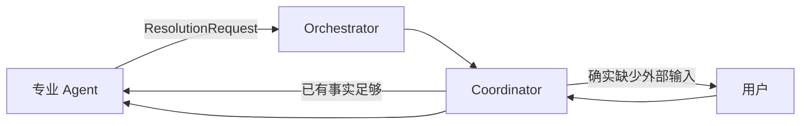
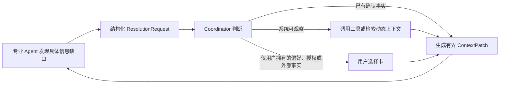

# MAC 设计理念

> 本文定义 MAC（Multi-Agent Coding System）的长期产品与技术设计原则。
> 它描述的是系统应当遵守的稳定理念，而不是某一版实现细节。架构、Prompt、状态机、飞书卡片、Agent 合同和测试方案发生冲突时，应优先回到本文判断设计是否合理。

## 1. 产品定位

MAC 不是一组 Agent 的聊天群，也不是把传统研发流程简单搬到飞书中的审批系统。

MAC 是一个面向真实软件交付的 AI 工程系统：

1. 用户通过一个统一入口表达目标、反馈、偏好和授权；
2. Coordinator 理解多轮对话，并把自然语言编译成结构化交付合同；
3. Orchestrator 以确定性方式调度专业 Agent、管理状态、恢复失败并投递通知；
4. Requirements、Architect、Coder、Tester、Reviewer、Acceptance 等 Agent 在有限职责和有限上下文中完成专业工作；
5. 系统通过真实运行入口和版本化证据判断交付是否完成；
6. 用户能够清楚看到系统做了什么、为什么这样推进、当前处于什么状态，以及是否真的需要自己介入。

MAC 的目标不是让用户管理 Agent，而是让用户获得一个能够自主完成工程闭环的 AI 工程伙伴。

## 2. 总体原则

### 2.1 系统承担复杂度，用户表达真实意图

用户不应学习状态机、Agent 分工、Prompt、Schema、任务 ID 或内部失败类型。用户只需表达：

- 想实现或修改什么；
- 对结果有什么偏好；
- 是否授予某项权限；
- 系统无法自行观察的外部事实；
- 对当前结果有什么真实反馈。

需求拆解、责任分配、技术判断、测试、评审、返工和可观察验收应尽量由 MAC 自己完成。

### 2.2 架构简洁，责任边界清晰

增加 Agent、状态、服务或协议不是能力提升本身。每个组件必须有独立且稳定的责任；无法明确责任边界的组件不应被引入。

复杂度应主要存在于结构化数据和可靠性机制中，而不应表现为：

- 多个 Agent 同时面对用户；
- 同一规则散落在 Handler、Prompt、Orchestrator 和卡片层；
- 多份状态互相复制；
- 为单个失败案例增加关键词分支；
- 用更多确认步骤掩盖系统无法判断的问题。

### 2.3 AI 负责语义，程序负责确定性

自然语言理解、需求归纳、专业判断和方案选择由 Agent 完成；以下事项由确定性代码保证：

- 状态转换；
- 权限边界；
- 幂等与并发控制；
- 任务调度与取消；
- Schema 校验；
- 事实和上下文版本；
- 通知投递与去重；
- 证据有效性；
- 卡片状态投影。

Handler、状态机和权限层不得通过关键词、同义词表或错误文案猜测自然语言语义。

### 2.4 以结果和证据推进，不以 Agent 话术推进

Agent 声称“完成”或“通过”不等于交付完成。状态推进必须建立在结构化产物和有效证据之上。

证据至少应明确：

- 对应哪条验收标准；
- 验证了什么行为；
- 从什么入口验证；
- 使用什么环境；
- 对应哪个代码或运行版本；
- 实际观察结果；
- 是否存在限制或未验证项。

代码已写入、测试已通过、服务已运行和用户可从公开入口使用，是不同状态，不得互相替代。

### 2.5 自主但不越权

MAC 应尽量减少 Human-in-the-loop，但不能用自动化冒充用户授权、偏好或外部观察。

默认决策顺序是：

1. 使用已确认且仍有效的事实；
2. Coordinator 判断是否可由现有系统能力解决；
3. 必要时询问相应专业 Agent；
4. 改变内部方法、责任阶段或 Runtime；
5. 只有缺少用户偏好、授权或系统无法获取的外部事实，并且该信息会实质改变结果时，才询问用户。

## 3. 核心技术架构理念

### 3.1 Coordinator 是唯一面向用户的智能入口

用户只与 Coordinator 建立连续关系。Coordinator 负责：

- 多轮对话与话题关联；
- 当前项目和用户意图识别；
- 需求、反馈和纠正的归一化；
- 选择哪些事实与当前任务相关；
- 回答普通 Agent 的内部澄清；
- 判断是否需要询问用户；
- 向用户解释当前有效状态和下一步。

Coordinator 不直接编码，也不替 Tester、Reviewer 或 Acceptance 篡改专业结论。

“唯一 Coordinator”指统一身份、连续上下文和统一决策责任，不要求每一轮都加载全部工程合同。Coordinator 应按需获取项目快照、WorkItem、事实、反馈和工具能力，普通对话不应携带完整交付上下文。

项目关联目录与 Coordinator 读取范围是两个概念。关联目录决定交付归属、默认工作目录和写入目标；Coordinator 可在系统配置的宿主根目录内按需只读其他项目或普通目录，用于参考、比较和取得事实，不要求用户切换绑定。读取参考目录不会改变项目归属，也不会自动把该目录的写权限或全部内容传给 Coder、Tester 等专业 Agent；Coordinator 只把当前 WorkItem 需要的事实和显式上下文交给它们。

### 3.2 Orchestrator 是 Coordinator 使用的确定性执行引擎

Orchestrator 不是第二个对话 Agent，也不负责自由理解用户语言。它负责：

- 状态机执行；
- WorkItem 创建；
- Agent 调度；
- attempt、重试、取消和恢复；
- context version 校验；
- Feedback 路由；
- Evidence 生命周期；
- Notification Outbox；
- 项目并发与幂等。

Orchestrator 应尽量保持薄，只编排专业组件，而不是在一个巨型类中实现所有业务规则。

### 3.3 专业 Agent 只处理自己的责任域

专业 Agent 只接收当前 WorkItem 所需的上下文，不接收完整用户对话，也不读取与项目无关的宿主机文件。

Agent 缺少信息时提交结构化 ResolutionRequest 或 QuestionBatch：



专业 Agent 不直接向用户提问。只有 Coordinator 可以决定是否升级用户。

### 3.4 WorkItem 是 Agent 执行的唯一当前合同

WorkItem 应明确：

- owner 和 stage；
- objective；
- relevant facts；
- scope 和 constraints；
- acceptance criteria；
- artifact references；
- open feedback；
- allowed capabilities；
- completion conditions；
- performance budget；
- context version。

历史聊天、旧规划文件和旧验收结果只能作为有版本的参考或证据，不能静默扩张当前合同。

WorkItem 必须携带确定性的 artifact contract fingerprint。当当前 Requirements、Architecture、Specs 或参考 manifest 与上一次成功对齐的合同不同时，Coder、Tester 和 Reviewer 必须把全部当前 AC 视为 in-scope；一条旧的窄范围 FeedbackPacket 不能把整体升级后的合同再次缩成单个历史 AC。基于旧合同指纹生成的证据属于 stale，不能因为最新代码 diff 看起来较小就重新标记为当前证据。

反馈关闭遵循交付语义，而不是文档状态。只影响规划产物本身的驳回或澄清可以在对应产物确认后关闭；用户 correction 和 scope change 必须继续向下游传递，直到实现和独立质量证据验证最终用户可见行为。仅更新 Requirements 不等于用户报告的产品缺陷已经修复。

### 3.5 每轮使用最小充分上下文

MAC 追求的不是单纯减少上下文，而是在每一轮向 Agent 提供完成当前 WorkItem **必需且充分**的上下文。已经确认会影响本轮判断的信息应默认提供；无关信息不得注入；仅仅“可能有用”的历史经验、参考资料和大型证据应按需动态加载。

每轮默认上下文应限定为：

- 当前 Agent 的职责、权限和完成边界；
- 当前 WorkItem 中真正 in-scope 的目标、AC、约束和完成条件；
- 与本轮直接相关且仍有效的确认事实；
- 尚未关闭并路由到当前责任阶段的 FeedbackPacket；
- Coordinator 针对本轮给出的决定及其因果依据；
- 当前输出 Schema 和必要的 Runtime capability reference。

以下内容默认不得整包注入：

- 完整聊天历史；
- 与本轮无关的 AC、旧产物和已关闭反馈；
- 上下游 Agent 的完整原始输出；
- 所有通用 Skill 或历史经验全文；
- 因“可能有帮助”而附带的仓库、日志和测试材料；
- 已由 Schema 或确定性校验器表达、又在 Prompt 中逐字段重复的合同。

可能需要的历史经验、专用 Skill、参考项目证据、运行日志和旧测试结果，应先以短索引或 capability manifest 暴露，在 Agent 确认用途后由工具、Coordinator 或 Orchestrator 返回有界的 `ContextPatch`。动态补丁必须带来源、时间、适用范围和关联 WorkItem/AC；不得把一次按需加载永久升级为所有后续任务的默认上下文。

跨仓库复用同样遵循这一规则。用户授权参考、复制或迁移另一个项目时，Coordinator 应形成结构化 `ResourceRef`，明确源根目录、用途、复用策略和需要的代码/数据资产；Orchestrator 把有界的只读语义快照放进任务目录，Coder 可以直接复制或改造已有实现。禁止把源仓库全文塞进 Prompt，也禁止因为目标项目不同就强迫 Agent 重写已经存在的通用代码；未被合同点名的大型日志、缓存、模型和历史数据库不得自动复制。

“完整参考”必须从源事实而不是 Git 提交习惯推导。Orchestrator 应生成包含 Git 已跟踪文件和安全本地资产的仓库 manifest；未跟踪的 Prompt、few-shot、Skill、知识 Wiki 或领域数据不能被静默遗漏。manifest 从 Requirements 开始贯穿 Architecture、Spec、Coder、Tester、Reviewer 和 Acceptance：上游据此形成逐能力处置合同，下游据此复制/适配和独立抽取差分样本。只有目标项目自己编写的测试、少数手工示例或“文件存在”检查，不能证明完整迁移。

上下文不足时使用内部闭环：



专业 Agent 不应因为系统没有预先塞入全部历史就直接询问用户；Coordinator 也不应把完整工程上下文放进每次普通对话。系统需要同时监测 Prompt 大小、未被使用的注入比例、因上下文缺失产生的重试，以及同一事实跨 WorkItem、报告和 Prompt 的重复次数。

### 3.6 事实必须有来源、作用域、时间和版本

事实不是一段无限增长的聊天摘要。每条事实都应具有：

- 稳定键；
- 来源；
- 作用域；
- 生效时间；
- 状态；
- 可信度；
- 敏感度；
- 替代关系。

新事实替代旧事实时，旧事实应标记为 superseded，而不是直接覆盖后失去历史。Agent 只获得与当前 WorkItem 相关的 active facts。

密钥原值不得作为普通事实进入 Prompt、日志、Artifact 或 WorkItem。系统只传递能力引用，并在受控 Runtime 边界注入实际值。

### 3.7 每类状态只有一个权威来源

结构化模型一旦建立，就不应长期在通用 JSON context 中再维护一份同义状态。

例如：

- Approval 是决策生命周期的权威来源；
- FeedbackPacket 是质量反馈的权威来源；
- ProjectContextRecord 是确认事实的权威来源；
- AcceptanceEvidence 是验收证据的权威来源；
- TaskFailureReport 是技术执行失败的权威来源；
- NotificationOutbox 是用户通知投递的权威来源。

通用 context 只适合短期迁移字段或无法独立建模的轻量元数据，不应成为流程状态杂物箱。

## 4. 产品交互理念

### 4.1 少输入、易输入、自由输入

MAC 要减少的是用户输入成本，而不是系统输出。

用户应当可以：

- 直接使用自然语言；
- 点击推荐选项；
- 在选择的同时补充详情；
- 使用命令作为快捷入口；
- 暂时不回答旧问题，先问另一个问题；
- 随时补充需求、纠正理解或提交可见缺陷。

能用有限选项表达的问题，应优先提供选择题和推荐项，同时保留自定义答案。不得为了结构化系统内部数据，要求用户手工填写长篇格式化内容。

### 4.2 输出充分、结构化、可追踪

减少用户打扰不等于减少输出。以下信息应充分展示：

- 当前目标；
- 当前阶段；
- 正在执行的 Agent；
- 阶段汇报；
- Coordinator 或 Agent 已作出的选择；
- 测试、Review 和验收结论；
- REWORK 原因、责任阶段和回退目标；
- 临时失败、恢复结果和最终失败；
- 当前是否需要用户操作；
- 运行时间和成本。

不应把内部 Prompt、数据库 ID、状态机枚举、完整工具日志和无关调试信息占据主界面。必要时可以提供展开或诊断入口。

### 4.3 所有系统输出统一使用卡片

用户可以自由输入文本，但 MAC 给用户的所有输出都应使用飞书卡片，包括：

- 普通问答；
- 帮助和项目列表；
- 项目创建、切换、绑定和终止结果；
- 进度和阶段转换；
- 汇报、确认、澄清和 REWORK；
- 权限、过期、错误和恢复提示；
- 自动决策结果；
- 最终交付结果。

卡片是统一的交互与状态载体，不只是视觉包装。裸文本发送只可作为飞书卡片服务完全不可用时的明确降级手段，并应被记录为 delivery degradation。

### 4.4 卡片类型各司其职

#### 进度卡

投影项目当前状态，应优先原地更新：

- 当前阶段和 Agent；
- 当前工作；
- 最近完成事项；
- 是否等待用户；
- 最近错误或恢复；
- 耗时与成本。

#### 汇报卡

投影某一 Agent、某一阶段、某一轮次的产物，是不可变历史快照。内容较长时允许按飞书限制拆分为多张卡片，但必须具有共同的 report ID、页码、总页数、项目、阶段、轮次和 artifact revision。

#### 决策卡

确认卡、选择卡、澄清卡和 REWORK 卡都属于决策卡。它们投影一个 Approval、PendingAction 或 QuestionInteraction 的生命周期。

#### 状态转换卡

投影一次不可变的状态转换事件，说明从哪里到哪里、由谁触发、依据是什么。

#### 结果卡

投影项目完成、取消、最终失败或等待外部事实等重要结论。

### 4.5 卡片状态必须与后台权威状态一致

每张可操作卡都必须有明确生命周期：

```text
pending
  -> resolved_by_user
  -> resolved_by_coordinator
  -> auto_resolved
  -> expired
  -> superseded
```

决策完成后，原卡片必须更新为只读完成态，并显示：

- 选择了什么；
- 谁作出的选择；
- 选择时间；
- 决策依据摘要；
- 导致的下一状态；
- 是否仍有待办。

用户选择、Coordinator 自动选择、质量 Agent 结论和系统策略选择必须使用同一套卡片完成机制。不能出现后台已经选择、飞书卡片仍无选择结果或仍保留可点击按钮的情况。

历史汇报卡保持历史快照；项目进度卡显示当前项目状态；决策卡显示对应决策对象的最终状态。所谓前后端一致，不是让所有历史卡片都改成项目最新状态，而是每张卡准确投影自己负责的后台对象。

### 4.6 外部卡片系统采用可靠的最终一致性

数据库事务与飞书 API 无法形成同一个原子事务，因此后台是权威来源，卡片通过 Notification Outbox 和 Card Projection 最终收敛。

一次决策应当按以下顺序处理：

1. 在同一数据库事务中保存 Decision、Approval 结果和 StateTransition；
2. 写入卡片更新意图；
3. 用户点击场景优先通过 action response 立即更新原卡片；
4. Agent 或 Coordinator 自动决策通过保存的 message ID 主动 PATCH 原卡片；
5. 更新失败时由 Outbox 重试；
6. 无法更新原卡片时发送替代完成卡，并将旧卡再次点击的响应更新为“已处理”；
7. Admin 能看到后台状态、卡片投影版本和最后投递错误。

系统不得静默接受后台与飞书长期不一致。

### 4.7 允许自然对话中的话题切换

用户没有回答旧问题而提出新问题时：

1. 正常回答新问题；
2. 保留旧问题为 pending；
3. 不把新消息强行解释成旧问题答案；
4. 不重复发送同一张待办卡；
5. 真正推进到依赖该答案的位置时再提示。

项目运行中的状态查询、成本查询或普通问答不得中断原任务。

## 5. 迭代与交付流程理念

### 5.1 流程按任务和风险自适应

MAC 不应让所有任务机械经过相同阶段。流程应根据以下因素选择最小充分链路：

- 是否是新项目；
- 是否已有绑定仓库；
- 需求和 AC 是否明确；
- 变更影响范围；
- 技术和数据风险；
- 是否影响用户可见行为；
- 当前是否已有有效证据；
- 是否属于完整参考能力复刻。

典型路径：

| 任务 | 建议流程 |
|---|---|
| 新产品或结构性功能 | Requirements -> Architect -> Spec -> Coder -> Tester -> Reviewer -> Acceptance |
| 已有仓库局部功能 | 增量合同 -> Coder -> Tester -> 风险化 Review -> Acceptance |
| 明确 Bug | Bug Analysis/复现 -> Coder -> 回归测试 -> Acceptance |
| 文案或局部 UI | Coder -> 定向测试 -> 用户可见入口验收 |
| 内部重构 | Coder -> Tester -> Reviewer；无用户行为变化时按风险决定 Acceptance |
| 文档 | Documentation Planning -> Writer/Coder -> 内容验证 -> Review |

“最小充分流程”不是降低质量标准，而是为每条 AC 选择足够且匹配的证据，避免所有 Agent 重复验证同一件事。

### 5.2 一次确认后立即开始交付

当 Coordinator 已形成明确目标、范围、AC 和执行授权后，应直接启动状态机，不重复要求用户确认同一事实。

规划确认、质量确认和验收判断默认由 Coordinator 或专业证据完成。只有 strict 模式或确实需要用户偏好、授权和外部事实时才等待用户。

即使系统自动选择，也必须发送并更新相应决策卡，让用户清楚看到选择及依据。

### 5.3 反馈必须直接进入责任 Agent 的下一轮合同

用户反馈、Tester 失败、Reviewer blocking issue 和 Acceptance 失败都必须形成结构化 FeedbackPacket，至少包含：

- 来源；
- 对应 AC；
- 实际观察；
- 期望结果；
- blocking 状态；
- 建议责任阶段；
- 相关证据；
- source task 和 round。

状态转入 REWORK 不等于反馈已经传递。责任 Agent 的下一轮 WorkItem 必须显式包含 open feedback。

### 5.4 REWORK 是正常质量闭环，不是系统崩溃

REWORK 应由结构化证据路由到最接近问题的责任阶段：

- 需求错误回到 Requirements；
- 架构问题回到 Architect；
- 实现合同错误回到 Spec；
- 代码缺陷回到 Coder；
- 验证器或测试缺口回到 Tester；
- 运行环境问题交给 Runtime/Infrastructure 处理。

系统应展示 REWORK 卡，明确失败、责任、回退目标和决策者。AI-first 模式下，如果证据足够，Coordinator 可以自动选择回退目标，但原 REWORK 卡必须显示已经选择的结果。

### 5.5 每一轮都应减少未解决问题

同一结构化失败连续重复时，系统不能盲目执行相同流程。应依次考虑：

- 是否没有把反馈传入正确 Agent；
- 是否使用了过期合同或证据；
- 是否回退到错误阶段；
- 是否验证方式本身有问题；
- 是否需要切换 Runtime 或交叉复核；
- 是否真的缺少用户独有信息。

只有穷尽系统内部合理路径后才升级用户。

### 5.6 新项目和已有项目使用同一质量理念

已有仓库增量迭代必须：

- 复用原目录和 Git 历史；
- 在隔离 worktree 中执行；
- 保留用户已有文件；
- 将新增 AC 与仍有效的历史回归合同合并；
- 只失效受变更影响的证据；
- 最终合并回原仓库。

不得把“迭代已有项目”退化成“新建一个相似但无关的项目”。

## 6. 质量、验收和用户责任

### 6.1 专业质量角色保持独立，但避免重复劳动

- Tester 负责运行测试、复现行为并发现功能缺陷；
- Reviewer 负责实现质量、风险和合同一致性，不默认重复 Tester 的完整执行；
- Acceptance Agent 从用户可见公开入口主动操作产品；
- 确定性 Evidence Policy 检查证据是否齐全；
- 只有证据冲突、语义模糊或高风险时，才需要额外的模型化 Acceptance Evaluator。

角色独立性的目的是防止自证，不是为了重复消耗相同成本。

### 6.2 用户只承担系统无法替代的验收责任

验收标准必须标明证据来源：

- `system_observable`：由 MAC 自己验证；
- `user_preference`：由用户表达偏好；
- `authorization`：由用户授权；
- `external_fact`：系统确实无法获取的外部观察。

MAC 不得把浏览器、CLI、API、日志或本机可观察行为转嫁给用户。能变成选择题的偏好和授权，应优先生成选择卡。

### 6.3 黑盒与白盒证据不能互相冒充

单元测试、API 测试、状态机模拟、真实飞书传输、真实私聊 UI、生成项目公开入口验收和内部主动验收分别证明不同问题。

修复用户可见问题后，必须回到相同层级的真实入口复测。查看代码或日志只能用于诊断，不能替代黑盒通过。

## 7. 性能、成本和可观测性理念

### 7.1 快是产品能力，不只是工程优化

用户感知时间至少应拆分为：

- Coordinator 响应；
- Agent 执行；
- 系统调度；
- 卡片投递；
- 等待用户；
- Runtime 重试或失控时间。

普通问答不应加载完整项目合同。Agent 只接收当前所需事实和证据。长 Prompt、重复合同和无关历史是架构问题，不应简单归因于模型慢。

### 7.2 成本必须真实、完整、可解释

系统应记录每种 Agent 和 Runtime 的：

- 调用次数；
- 执行时间；
- 工具调用数；
- 输入和输出规模；
- Runtime 已报告成本；
- 是否只是成本下限；
- 重试和 REWORK 造成的额外消耗。

Runtime 未报告成本时应显示未知，不得使用零伪装无成本。

### 7.3 可观测性面向两类用户

飞书面向产品用户，展示目标、阶段、结论、决策和必要操作。

Admin 和日志面向系统维护者，展示 Task、attempt、context version、Feedback、Evidence、Outbox、Runtime、卡片投影和失败详情。

产品界面不应被维护者信息淹没，维护界面也不能只剩模糊的用户话术。

## 8. 演进纪律

### 8.1 禁止单案例过拟合

任何问题都必须先确定根因属于：

- Prompt/Agent 合同；
- 上下文和事实；
- 反馈传递；
- 状态机和路由；
- Runtime；
- 通知与卡片投影；
- 生成项目本身；
- 外部依赖。

不得为某个项目名、用户措辞、错误文本或关键词添加专用分支。修复后必须使用不同措辞和相邻场景验证同类问题。

### 8.2 优先做减法

修复问题时优先考虑：

- 删除重复状态源；
- 统一重复的卡片生命周期；
- 收敛相同职责；
- 缩小 Prompt 和 WorkItem；
- 复用仍有效证据；
- 让现有组件边界更清楚。

只有现有模型无法表达必要概念时，才增加新组件、新 Agent 或新状态。

### 8.3 设计理念必须转化为可验证不变量

关键原则必须有自动化检查和真实入口场景，例如：

- 确定性路由层不存在自然语言关键词分类；
- Agent 只收到相关事实；
- Agent 默认只收到当前 WorkItem 的最小充分上下文，历史经验和专用 Skill 按需加载；
- 同一 AC、事实或证据不得在 WorkItem、Agent 报告和 Prompt 中无界重复；
- blocking feedback 必须进入责任 Agent 的下一轮 WorkItem；
- Coordinator 或 Loop Supervisor 改变默认回退阶段时，目标 Agent 必须同时收到触发该重路由的结构化反馈；状态边不能脱离因果证据单独流转；
- 同一通知意图不重复发送；
- 用户可见通知必须先持久化再投递；短暂网络失败后由统一 Outbox 消费者有限重试，不能只记录失败而永不补发；
- 所有系统输出都是卡片或明确记录的降级；
- 决策完成后原卡片显示选择、决策者和下一状态；
- 后台与卡片 projection version 最终一致；
- 用户切换话题不会关闭无关待办；
- 所有对话可变状态以当前 session 为边界；历史、摘要、项目选择、目录绑定、pending action、pending intent、澄清和审批上下文不得按用户全局回退到其他私聊或群聊。跨 session 复用只能由用户显式关联、绑定或切换；重新绑定目录必须原子清除该 session 的旧项目选择；
- 普通问答不会创建项目或打断运行任务；
- 已有项目迭代不会创建无关目录；
- 黑盒修复从相同真实入口复测。
- 缺陷修复必须同时覆盖同一不变量的不同表述或邻近边界；不得靠专用分支、错误文案匹配、删除断言或扩大样例词表让单个复现变绿。协议明确规定的固定 token 除外。

## 9. 非目标

MAC 不追求：

- 让用户观看 Agent 的私有思维过程；
- 为展示复杂度而展示所有内部日志；
- 让所有任务经过同样长的流程；
- 用更多 Agent 数量代表系统更先进；
- 用频繁询问用户规避系统决策责任；
- 用单测全绿代替真实产品体验；
- 让卡片成为只能点击、不能自由表达的表单系统；
- 为追求自动化而扩大权限边界。

系统应展示决策结果、证据和简明依据，但不需要暴露模型的私有推理链。

## 10. 设计评审问题

新增或修改任何 MAC 功能前，应回答：

1. 这项能力属于 Coordinator、Orchestrator、专业 Agent 还是确定性服务？
2. 是否引入了第二个状态真相源？
3. 是否让无关 Agent 获得了额外上下文？
4. 当前 Agent 缺少的内容能否按需加载，而不是扩大所有任务的默认 Prompt？
5. 是否增加了用户本可不必完成的输入？
6. 用户能否使用自然语言完成同一操作？
7. 系统输出是否使用卡片？
8. 卡片是否能够显示 pending、选择结果、决策者、时间和下一状态？
9. 后台变化后，原卡片和进度卡如何可靠更新？
10. 是否可以复用现有证据，而不是重跑全部流程？
11. 是否通过关键词或具体错误文案实现路由？
12. 失败反馈是否真正进入责任 Agent 的下一轮 WorkItem？
13. 修复后应该从哪个真实入口验证？
14. 是否能通过删除或统一现有机制实现，而不增加新层次？

## 11. 一句话原则

> MAC 应让用户以最自由、最省力的方式表达意图，让系统以充分、结构化、状态一致的卡片展示工作过程；由一个 Coordinator 统一理解和决策，由确定性的 Orchestrator 可靠执行，由专业 Agent 在最小充分上下文中完成工作，并以真实入口证据闭合每一次交付。
